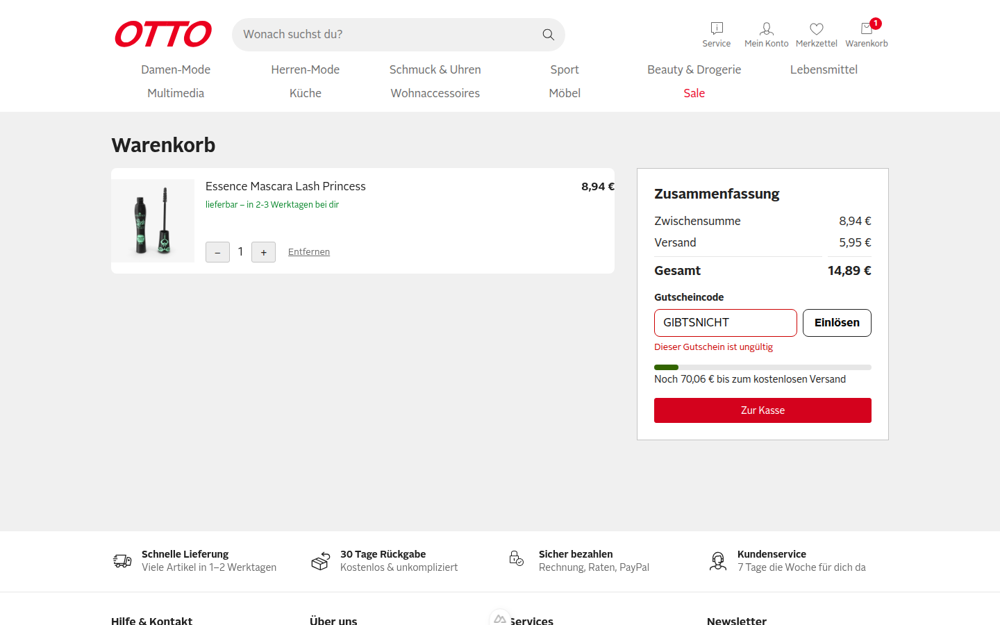
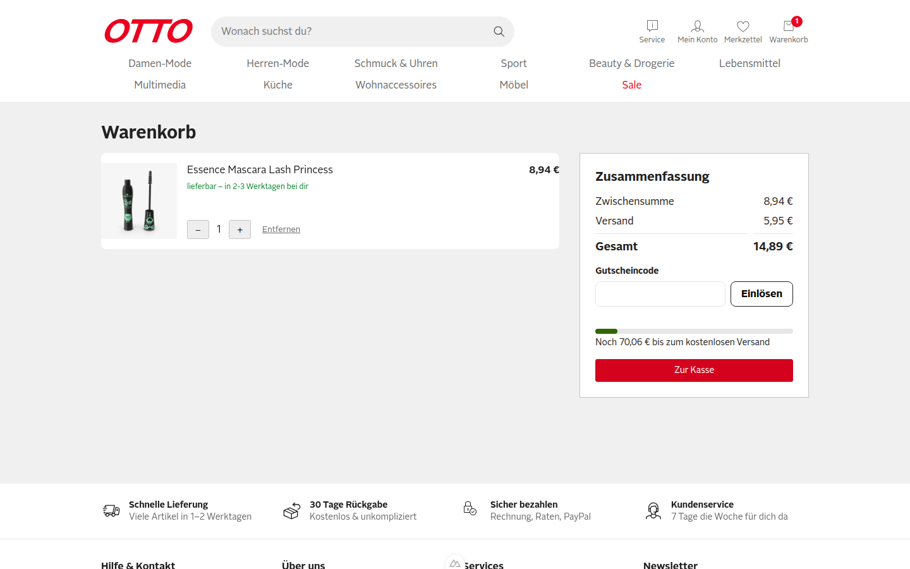
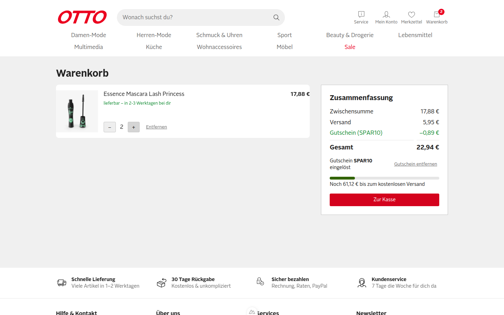
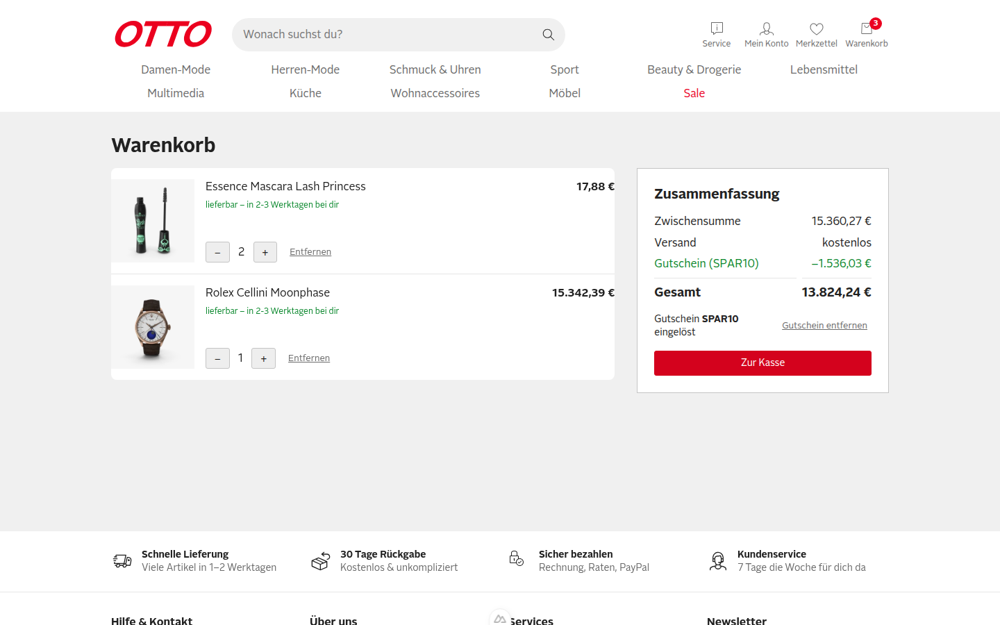
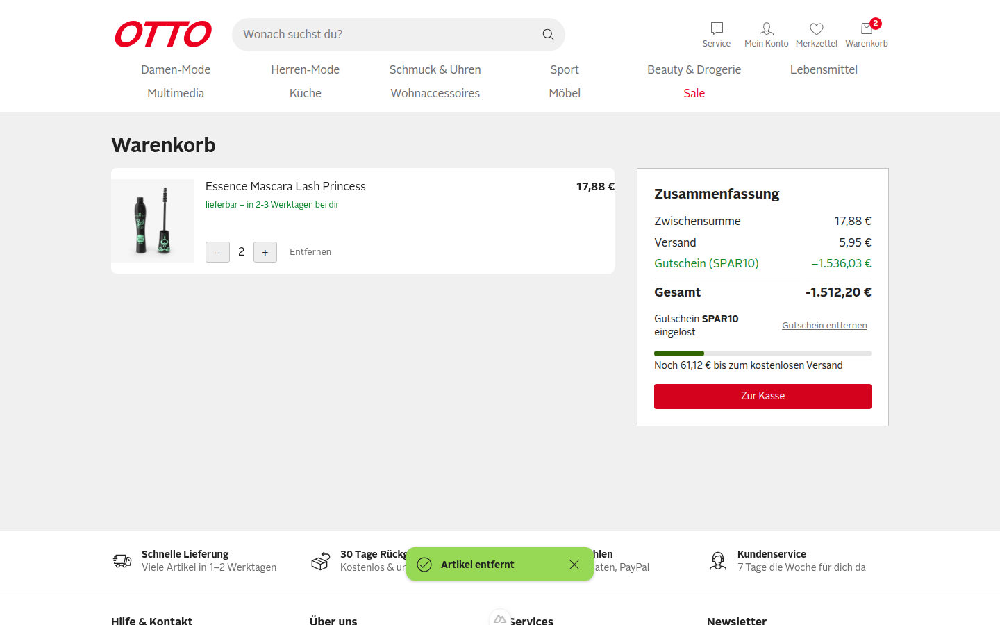
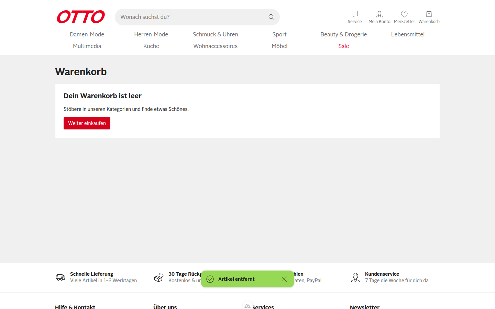

**Urteil: CRITICAL_BUGS**

# QA-Report PR #1 – SHOP-42: Gutscheincode im Warenkorb einlösen (Issue #2)

Getestet gegen `http://localhost:3100` (Commit `a2e93c6`), Chromium über agent-browser, Viewport 1440×900. Der Warenkorb wurde immer über den echten Nutzerweg befüllt (Produktseite → „In den Warenkorb“ → Header-Link „Warenkorb“). Alle Summen wurden aus `.summary__rows` gelesen und mit den Cookies abgeglichen.

[Video des Laufs](video/qa-run.webm)

**Kurzfassung:** Alle drei Gherkin-Szenarien bestehen. Der Rabatt wird aber **beim Einlösen als fester Eurobetrag eingefroren** (Cookie `otto-coupon-amount`) und danach nie neu berechnet. Ändert sich der Warenkorb, stimmt der Rabatt nicht mehr – bis hin zu **negativen Gesamtsummen**. Das verletzt die Regel „10 % Rabatt auf die Zwischensumme“.

## Ausgangszustand

1 × Essence Mascara (id 1): Zwischensumme 8,94 €, Versand 5,95 €, Gesamt 14,89 €.

## Szenarien aus dem Issue

| # | Szenario | Ergebnis | Beobachtung |
|---|----------|----------|-------------|
| S1 | Gültiger Gutschein | ✅ bestanden | Zeile „Gutschein (SPAR10) −0,89 €“ (= 10 % von 8,94 €, gerundet), Gesamt 14,89 € → 14,00 €, Cookie `otto-coupon=SPAR10` |
| S2 | Ungültiger Gutschein | ✅ bestanden | Meldung „Dieser Gutschein ist ungültig“, Feld rot markiert, Gesamt bleibt 14,89 €, kein `otto-coupon`-Cookie |
| S3 | Gutschein entfernen | ✅ bestanden | Rabattzeile weg, Gesamt wieder 14,89 €, `otto-coupon` gelöscht |
| R1 | Regel: Gutschein bleibt nach Reload | ✅ bestanden | Nach `reload` weiter −0,89 € / Gesamt 14,00 € |
| R2 | Regel: höchstens ein Gutschein | ✅ bestanden | Nach dem Einlösen wird das Eingabefeld durch „Gutschein SPAR10 eingelöst“ + „Gutschein entfernen“ ersetzt, ein zweiter Code ist nicht eingebbar (siehe S1-Screenshot) |
| R3 | Regel: 10 % auf die Zwischensumme | ❌ **nicht erfüllt**, sobald sich der Warenkorb nach dem Einlösen ändert | siehe F1–F3 |

### S1 – Gültiger Gutschein

### S2 – Ungültiger Gutschein

### S3 – Gutschein entfernen

### R1 – Persistenz nach Reload

## Funde

### F1 – Rabatt wird bei Mengenänderung nicht neu berechnet

**Severity: Major**

Ursache: `useCoupon.redeem()` speichert den Rabatt einmalig als Betrag in `otto-coupon-amount` (`app/composables/useCoupon.ts:15`), `discount` liest nur noch diesen Wert.

Repro:
1. 1 × Mascara (id 1) in den Warenkorb legen, `/warenkorb` öffnen.
2. `SPAR10` einlösen → Rabatt −0,89 €.
3. Bei der Position auf `+` klicken (Menge 2).

- **Erwartet:** Zwischensumme 17,88 €, Rabatt −1,79 € (10 %), Gesamt 22,04 €.
- **Ist:** Zwischensumme 17,88 €, Rabatt bleibt **−0,89 €** (5 %), Gesamt **22,94 €**.

### F2 – Gesamtsumme wird negativ, wenn nach dem Einlösen Artikel entfernt werden

**Severity: Critical**

Repro:
1. Warenkorb: 2 × Mascara + 1 × Rolex Cellini Moonphase (id 191) → Zwischensumme 15.360,27 €.
2. `SPAR10` einlösen → Rabatt −1.536,03 €, Gesamt 13.824,24 €.
3. Bei der Rolex auf „Entfernen“ klicken.

- **Erwartet:** Rabatt passt sich an (10 % von 17,88 € = −1,79 €), Gesamt 22,04 €.
- **Ist:** Rabatt bleibt **−1.536,03 €**, **Gesamt −1.512,20 €**. „Zur Kasse“ ist weiter aktiv. Es gibt auch keine Begrenzung des Rabatts auf die Zwischensumme.

### F3 – Gutschein samt altem Betrag überlebt einen leeren Warenkorb und gilt für den nächsten Einkauf

**Severity: Major**

Repro (Fortsetzung von F2):
1. Auch die letzte Position „Entfernen“ → „Dein Warenkorb ist leer“. Cookies: `otto-cart=[]`, aber `otto-coupon=SPAR10` und `otto-coupon-amount=1536.03` bleiben.
2. Mascara erneut über die Produktseite in den Warenkorb legen, `/warenkorb` öffnen.

- **Erwartet:** Beim Leeren verfällt der Gutschein (oder er wird für den neuen Warenkorb mit 10 % neu berechnet: −0,89 €, Gesamt 14,00 €).
- **Ist:** Der neue Warenkorb zeigt sofort „Gutschein (SPAR10) −1.536,03 €“ und **Gesamt −1.521,14 €**, ohne dass der Kunde etwas eingelöst hat.

### F4 – Rabattbetrag kommt ungeprüft aus einem Client-Cookie

**Severity: Major** (Sicherheit/Manipulation; im Demo ohne echten Checkout, aber das Muster darf so nicht in die Kasse)

Repro:
1. 1 × Mascara, `SPAR10` eingelöst (Gesamt 14,00 €).
2. Im Browser das Cookie `otto-coupon-amount` auf `14.89` setzen, Seite neu laden.

- **Erwartet:** Der Rabatt wird aus Code + Zwischensumme berechnet, der Wert im Cookie wird ignoriert → −0,89 €.
- **Ist:** Rabatt **−14,89 €**, Gesamt wird als **„-0,00 €“** angezeigt (auch die Formatierung mit negativem Vorzeichen ist falsch). Jeder beliebige Betrag ist so einstellbar, ohne Obergrenze.

## Weitere explorative Prüfungen (ohne Fund)

- Eingabe in Kleinbuchstaben mit Leerzeichen (`" spar10 "`) und Absenden per **Enter** → wird korrekt als SPAR10 erkannt, Rabatt −0,89 € (Screenshot oben bei F4 „Vorher“: `12-e1-kleinschreibung-enter-ok.png`).
- Fehlermeldung bei ungültigem Code liegt in einer `role="alert"`-Region, das Feld bekommt `aria-invalid` – gut für Screenreader.
- Versandschwelle (79 €) wird wie dokumentiert auf die Zwischensumme **vor** Rabatt angewendet (bei 15.360,27 € „kostenlos“).

## Empfehlung

Statt eines Betrags nur den Code speichern und den Rabatt als `computed` aus aktueller Zwischensumme × Satz berechnen (auf die Zwischensumme gedeckelt). `otto-coupon-amount` entfällt damit. Beim Leeren des Warenkorbs den Gutschein ebenfalls entfernen. Danach F1–F4 erneut prüfen.
