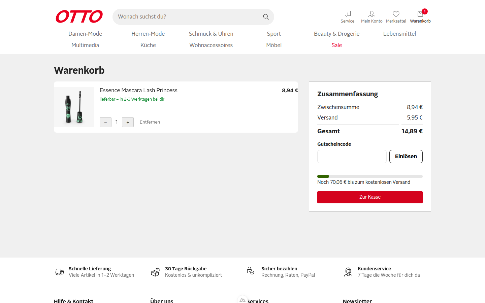
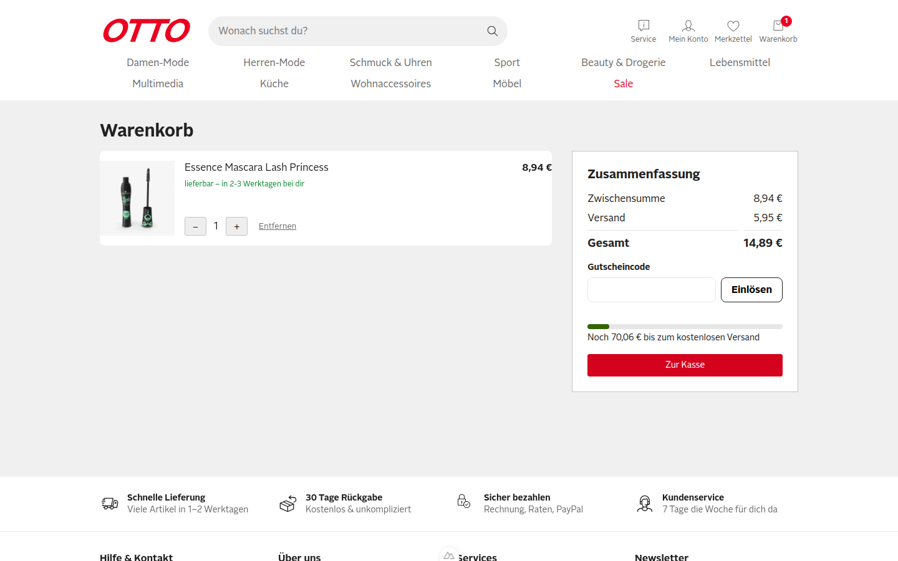
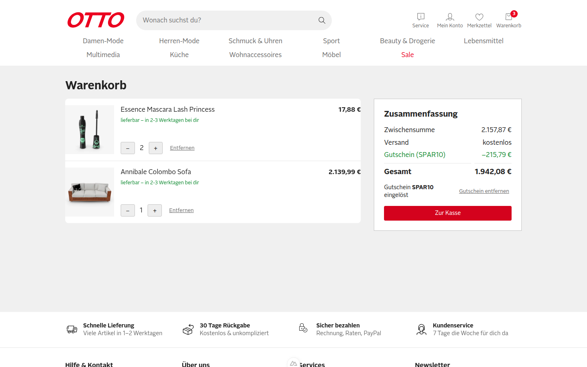
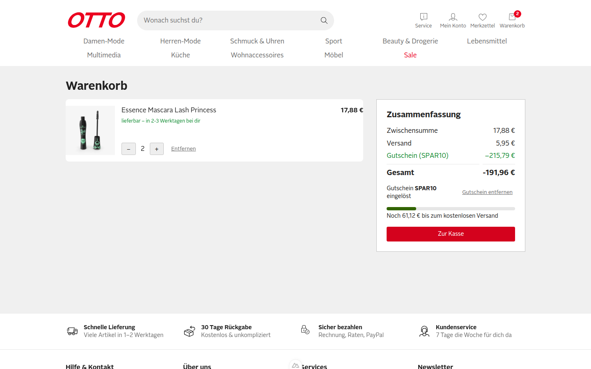
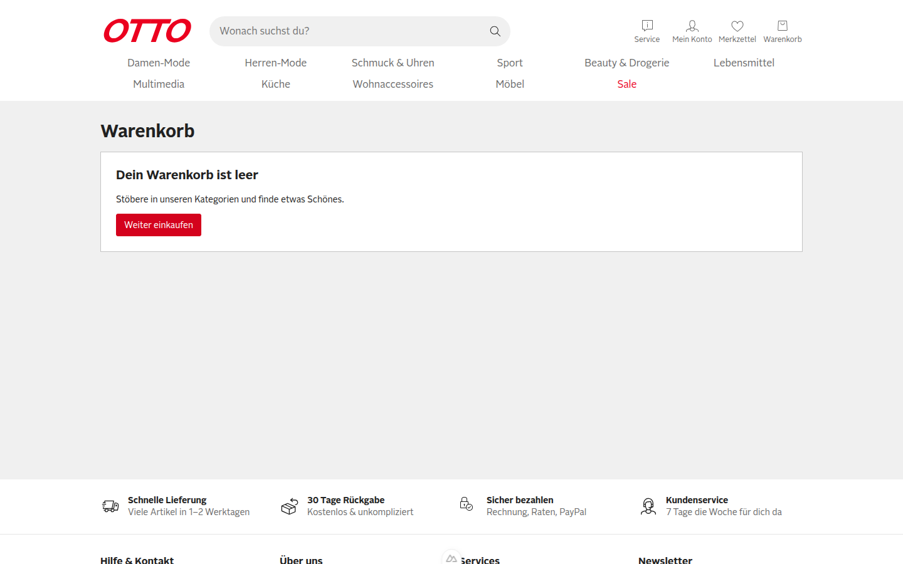
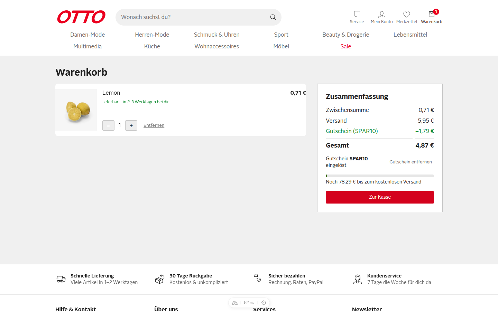
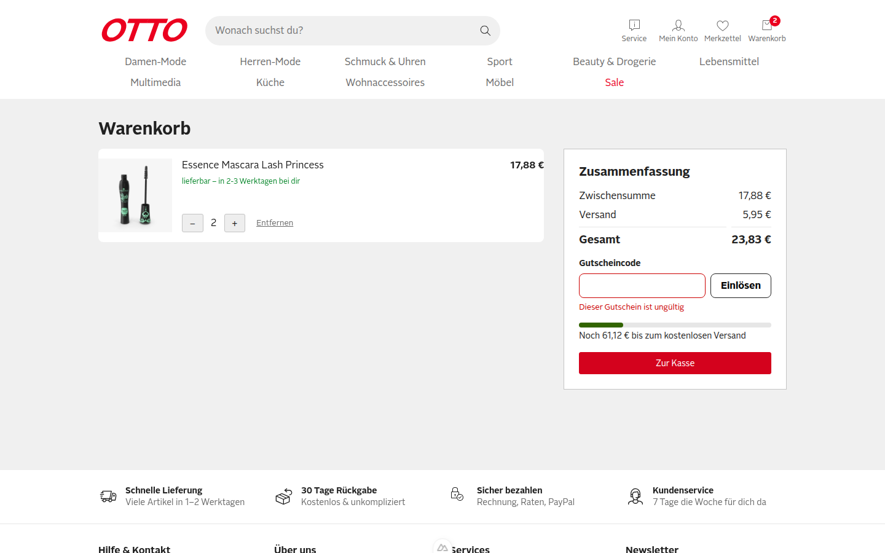

**Urteil: CRITICAL_BUGS**

# QA-Report – PR #1 / Issue #2 „SHOP-42: Gutscheincode im Warenkorb einlösen“

Getestet im echten Browser (agent-browser, Session `otto-verify-3100`, Viewport 1440×900) gegen http://localhost:3100, Commit `f4cb7c5`. Doctor: alle Checks `ok`. Warenkorb immer über die Produktseite → „In den Warenkorb“ → Header „Warenkorb“ befüllt, keine Cookies von Hand gesetzt.

[Video des Laufs](video/qa-run.webm)

**Kurzfassung:** Alle drei Gherkin-Szenarien sind bestanden. Der Rabatt wird aber nur einmal beim Einlösen berechnet und als fester Betrag im Cookie `otto-coupon-amount` gespeichert (`app/composables/useCoupon.ts:15`). Ändert sich danach der Warenkorb, stimmt der Rabatt nicht mehr. Im schlimmsten Fall wird die Gesamtsumme **negativ** (−191,96 €).

## Ausgangszustand

1 × Essence Mascara (id 1): Zwischensumme 8,94 €, Versand 5,95 €, Gesamt 14,89 €.

## Szenarien

| # | Szenario | Ergebnis | Beleg |
|---|---|---|---|
| S1 | Gültiger Gutschein | ✅ bestanden | 03 |
| S2 | Ungültiger Gutschein | ✅ bestanden | 02 |
| S3 | Gutschein entfernen | ✅ bestanden | 05 |
| R | Regel: Gutschein bleibt nach Reload erhalten | ✅ bestanden | 04 |
| R | Regel: höchstens ein Gutschein pro Bestellung | ✅ bestanden (Eingabefeld verschwindet nach dem Einlösen) | 11 |

### S1 – Gültiger Gutschein ✅
„SPAR10“ eingelöst. Rabattzeile „Gutschein (SPAR10)“ zeigt −0,89 € (10 % von 8,94 €, gerundet). Gesamt sinkt von 14,89 € auf 14,00 €. Cookie `otto-coupon=SPAR10`.

### S2 – Ungültiger Gutschein ✅
„GIBTSNICHT“ eingelöst. Die Meldung „Dieser Gutschein ist ungültig“ erscheint. Gesamt bleibt 14,89 €, es gibt keine Rabattzeile und kein `otto-coupon`-Cookie.

### S3 – Gutschein entfernen ✅
„Gutschein entfernen“ geklickt. Die Rabattzeile verschwindet, Gesamt ist wieder 14,89 €, das Cookie `otto-coupon` ist weg.

### Regel – Persistenz nach Reload ✅
Nach `reload` sind Rabattzeile −0,89 € und Gesamt 14,00 € unverändert.

## Funde

### F1 – Rabatt wird bei Mengenänderung nicht neu berechnet · Severity: **Hoch**
Der Rabattbetrag wird beim Einlösen eingefroren (`otto-coupon-amount`). Eine Mengenänderung danach berechnet ihn nicht neu. Das verletzt die Regel „10 % Rabatt auf die Zwischensumme“.

**Repro**
1. Produkt id 1 in den Warenkorb legen, `/warenkorb` öffnen.
2. „SPAR10“ einlösen → −0,89 €.
3. Menge mit `+` auf 2 erhöhen.

**Erwartet:** Zwischensumme 17,88 € → Rabatt −1,79 €, Gesamt 22,04 €.
**Ist:** Rabatt bleibt −0,89 €, Gesamt 22,94 € (0,90 € zu viel).

Vorher (1 Stück, Rabatt −0,89 €):

Nachher (2 Stück, Rabatt immer noch −0,89 €):

### F2 – Gesamtsumme wird negativ, wenn ein Artikel nach dem Einlösen entfernt wird · Severity: **Kritisch**
Gleiche Ursache wie F1. Wird nach dem Einlösen ein teurer Artikel entfernt, bleibt der hohe Rabatt stehen. Die Gesamtsumme wird negativ, und das bleibt auch nach einem Reload so. „Zur Kasse“ ist dabei weiter aktiv.

**Repro**
1. 2 × Mascara (id 1) und 1 × Annibale Colombo Sofa (id 12) in den Warenkorb legen.
2. „SPAR10“ einlösen → Zwischensumme 2.157,87 €, Rabatt −215,79 €, Gesamt 1.942,08 €.
3. Beim Sofa auf „Entfernen“ klicken.

**Erwartet:** Rabatt −1,79 € (10 % von 17,88 €), Gesamt 22,04 €.
**Ist:** Rabatt −215,79 €, **Gesamt −191,96 €**. Nach einem Reload ist der Stand unverändert.

Vorher (Sofa im Warenkorb, Rabatt −215,79 €):

Nachher (Sofa entfernt, Gesamt −191,96 €):

### F1b – Gutschein überlebt einen leeren Warenkorb, alter Rabatt ist größer als die neue Zwischensumme · Severity: **Hoch**
Gleiche Ursache. Wird der Warenkorb geleert, bleiben `otto-coupon=SPAR10` und `otto-coupon-amount=1.79` stehen. Ein später hinzugefügter Artikel bekommt den alten Betrag als Rabatt, auch wenn dieser höher ist als die Zwischensumme.

**Repro**
1. Mit eingelöstem SPAR10 (Rabatt −1,79 €) die letzte Position per „Entfernen“ löschen → „Dein Warenkorb ist leer“, Cookies enthalten weiter `otto-coupon=SPAR10`, `otto-coupon-amount=1.79`.
2. Produkt id 31 (Lemon, 0,71 €) in den Warenkorb legen, `/warenkorb` öffnen.

**Erwartet:** Rabatt −0,07 € (10 % von 0,71 €), Gesamt 6,59 €. Alternativ wird der Gutschein mit dem leeren Warenkorb verworfen.
**Ist:** Rabatt −1,79 € bei einer Zwischensumme von 0,71 €, Gesamt 4,87 €.

Vorher (leerer Warenkorb, Gutschein-Cookies bleiben):

Nachher (Rabatt −1,79 € > Zwischensumme 0,71 €):

**Ursache (für F1, F1b, F2):** `useCoupon.ts` speichert `amount` als festen Wert im Cookie, statt `discount` als `computed` aus `subtotal × Satz` abzuleiten. `discount` sollte zusätzlich auf die Zwischensumme begrenzt sein.

### F3 – Leere Eingabe meldet „Dieser Gutschein ist ungültig“ · Severity: **Niedrig**
**Repro:** Ohne Eingabe auf „Einlösen“ klicken.
**Erwartet:** Ein Hinweis wie „Bitte Gutscheincode eingeben“ oder ein deaktivierter Button.
**Ist:** „Dieser Gutschein ist ungültig“, obwohl kein Code eingegeben wurde.

Vorher (leeres Feld, keine Meldung; der Zustand stammt aus S3, in F3 war die Menge 2):

Nachher:

## Explorativ geprüft, ohne Befund
- Eingabe „ spar10 “ (Kleinschreibung, Leerzeichen) wird zu SPAR10 normalisiert. Der Rabatt −1,79 € auf 17,88 € ist korrekt, weil er frisch berechnet wird.
- Nach dem Einlösen wird das Eingabefeld durch „Gutschein SPAR10 eingelöst“ + „Gutschein entfernen“ ersetzt. Ein zweiter Gutschein ist nicht möglich.
- Die Fehlermeldung verschwindet beim Tippen (`#coupon-error` leer).
- Ein ungültiger Code setzt kein `otto-coupon`-Cookie.

## Nicht geprüft
- Mobile-Viewport (unter 900 px), Tastaturbedienung (Enter im Feld) und ein a11y-Audit.
