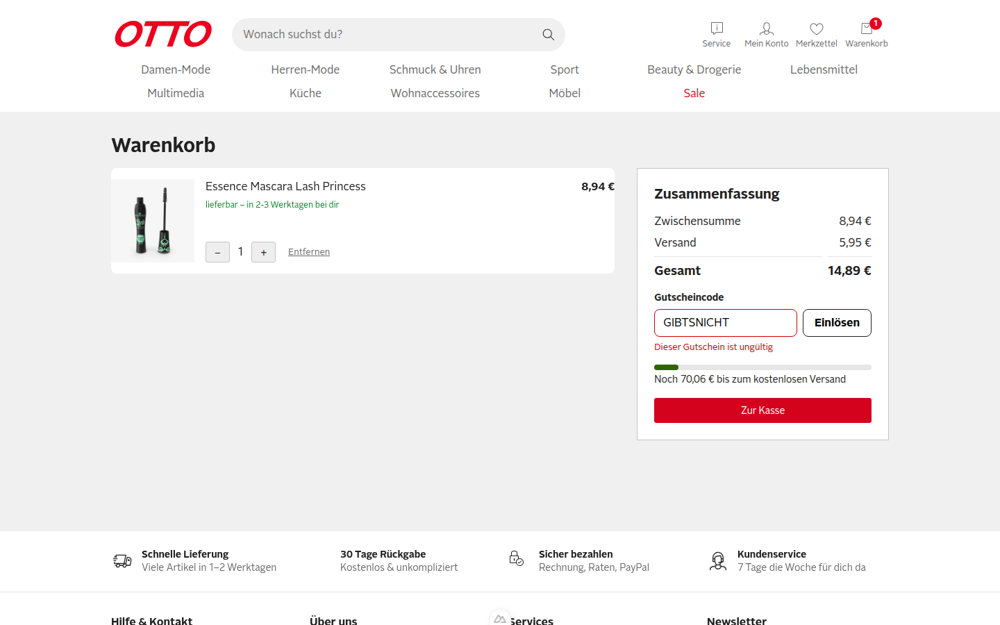
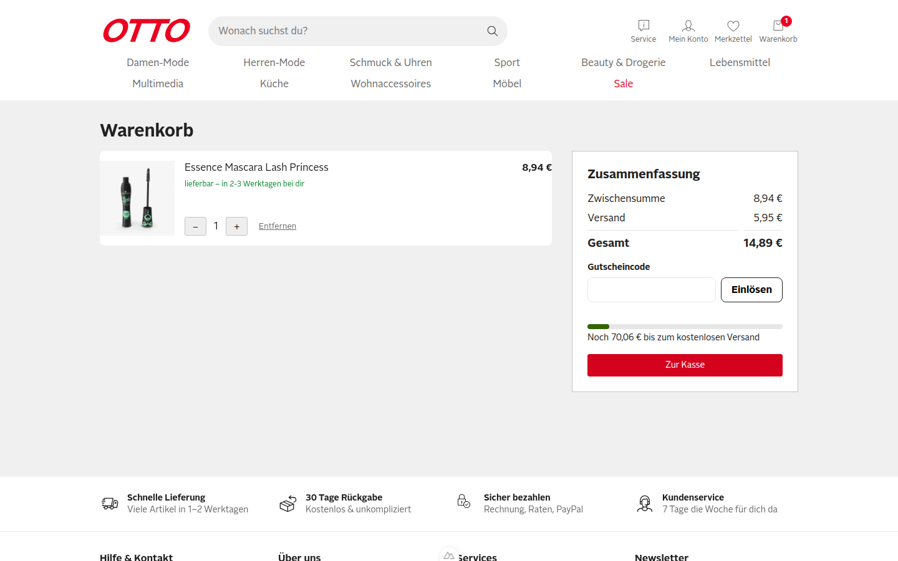
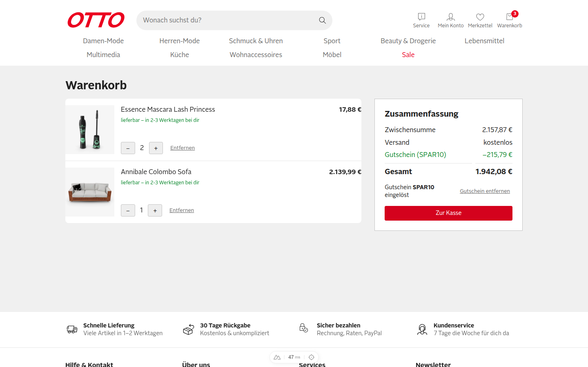
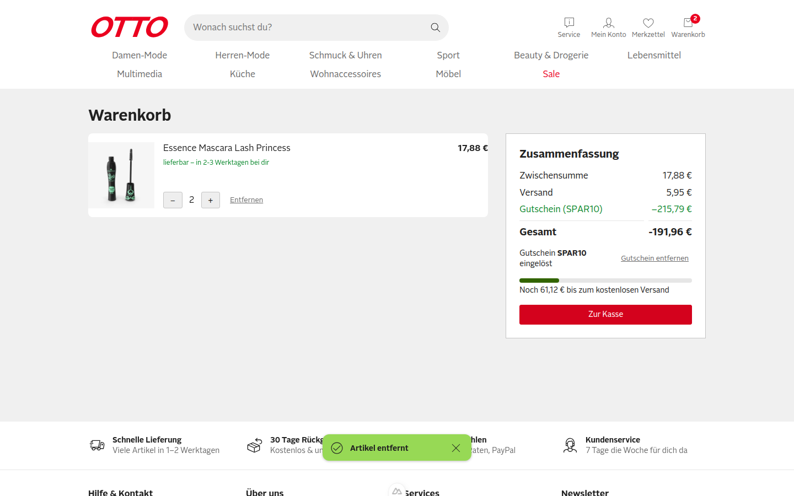
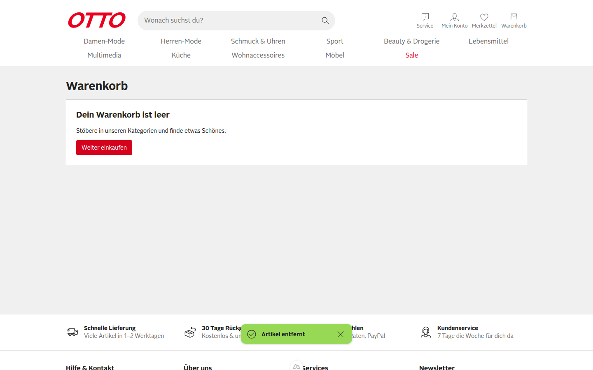
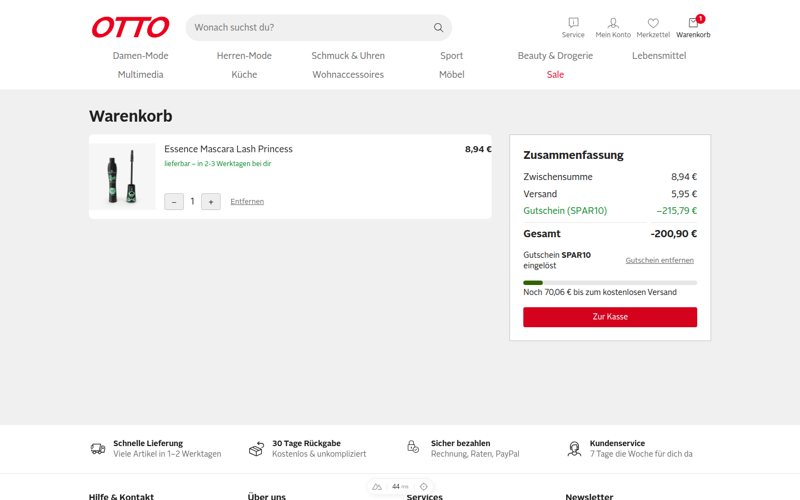
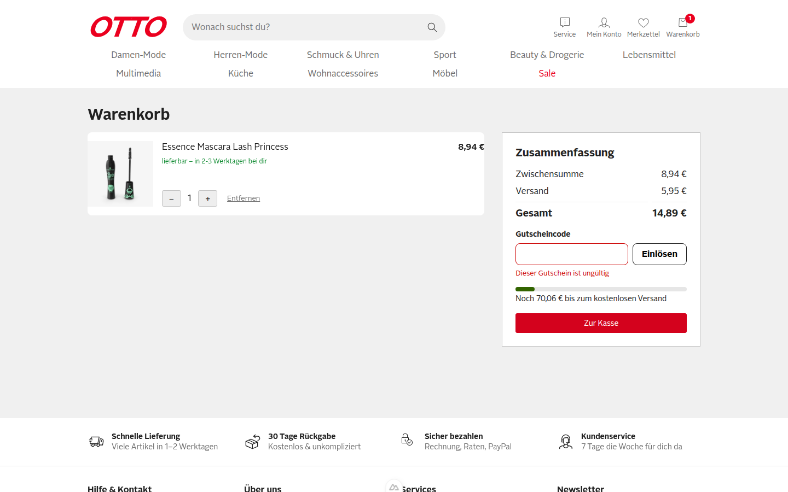
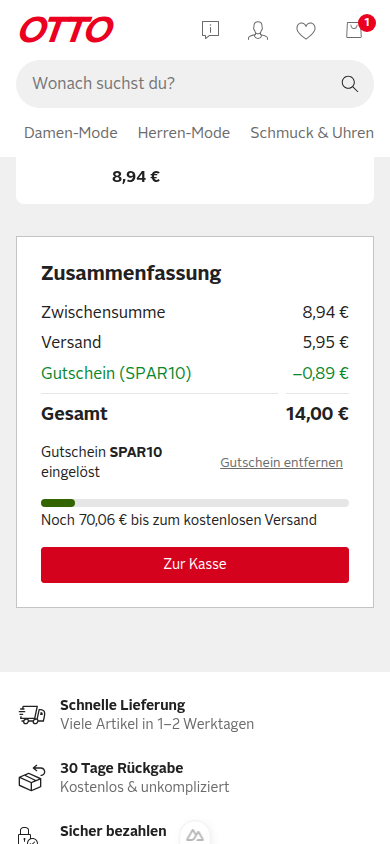

**Urteil: CRITICAL_BUGS**

# QA-Report PR #1 – SHOP-42: Gutscheincode im Warenkorb einlösen (Issue #2)

Getestet im echten Browser (agent-browser, Session `otto-verify-3100`) gegen http://localhost:3100, Desktop 1440×900 und mobil 390×844. Der Warenkorb wurde immer über „In den Warenkorb“ auf der Produktseite befüllt, Cookies wurden nicht von Hand gesetzt.

[Video des Laufs](video/qa-run.webm)

## Ergebnis der Szenarien aus dem Issue

| # | Szenario | Ergebnis |
|---|----------|----------|
| S1 | Gültiger Gutschein | ✅ bestanden |
| S2 | Ungültiger Gutschein | ✅ bestanden |
| S3 | Gutschein entfernen | ✅ bestanden |
| Regel | Gutschein bleibt nach Reload erhalten | ✅ bestanden |

Ausgangszustand: 1 × Essence Mascara (id 1). Zwischensumme 8,94 €, Versand 5,95 €, Gesamt 14,89 €.

### S1 – Gültiger Gutschein ✅
`SPAR10` eingegeben, „Einlösen“ geklickt. Die Rabattzeile „Gutschein (SPAR10) −0,89 €“ erscheint (10 % von 8,94 €). Gesamt sinkt von 14,89 € auf 14,00 €. Cookie `otto-coupon=SPAR10`.

### S2 – Ungültiger Gutschein ✅
`GIBTSNICHT` eingelöst. Die Meldung „Dieser Gutschein ist ungültig“ erscheint. Gesamt bleibt 14,89 €, es gibt keine Rabattzeile und kein `otto-coupon`-Cookie.

### S3 – Gutschein entfernen ✅
Bei eingelöstem SPAR10 „Gutschein entfernen“ geklickt. Die Rabattzeile verschwindet, Gesamt ist wieder 14,89 €, das `otto-coupon`-Cookie ist gelöscht.

### Regel – Persistenz nach Reload ✅
Nach `reload` sind Rabattzeile −0,89 € und Gesamt 14,00 € weiter da.

## Funde

Ursache aller drei Funde: `useCoupon.redeem()` (`app/composables/useCoupon.ts:15`) berechnet den Rabatt **einmal beim Einlösen** und speichert den festen Betrag im Cookie `otto-coupon-amount`. Danach wird er nicht mehr neu berechnet. Die Regel im Issue verlangt aber 10 % *der Zwischensumme*, also der aktuellen Summe. Auch Leeren des Warenkorbs setzt den Gutschein nicht zurück.

### F1 – Rabatt passt sich nicht an Mengenänderungen an (Severity: Major)

**Repro**
1. Produkt id 1 in den Warenkorb legen, Warenkorb öffnen.
2. `SPAR10` einlösen → Rabatt −0,89 €.
3. Menge mit `+` auf 2 erhöhen.

**Erwartet:** Zwischensumme 17,88 €, Rabatt −1,79 € (10 %), Gesamt 22,04 €.
**Ist:** Zwischensumme 17,88 €, Rabatt bleibt −0,89 €, Gesamt 22,94 €. Der Kunde wird um 0,90 € zu wenig rabattiert. Sinkt die Menge nach dem Einlösen, ist der Rabatt dagegen zu hoch (siehe F2).

### F2 – Gesamtsumme wird negativ, wenn nach dem Einlösen Artikel entfernt werden (Severity: Critical)

**Repro**
1. 2 × Produkt id 1 und 1 × Annibale Colombo Sofa (id 12) in den Warenkorb legen. Zwischensumme 2.157,87 €.
2. `SPAR10` einlösen → Rabatt −215,79 €, Gesamt 1.942,08 € (korrekt).
3. Beim Sofa „Entfernen“ klicken.

**Erwartet:** Zwischensumme 17,88 €, Rabatt −1,79 €, Versand 5,95 €, Gesamt 22,04 €.
**Ist:** Zwischensumme 17,88 €, Rabatt **−215,79 €**, Gesamt **−191,96 €**. „Zur Kasse“ bleibt aktiv. Der Zustand überlebt einen Reload, weil er im Cookie steht. Das ist ein Preis-/Umsatzfehler: Ein 10-%-Gutschein lässt sich so auf jeden beliebigen Betrag aufblasen. Nebenbei hat das negative Gesamt einen Bindestrich (`-191,96 €`), die Rabattzeile dagegen ein echtes Minus (`−`).

### F3 – Gutschein samt altem Betrag überlebt einen geleerten Warenkorb (Severity: Critical, gleiche Ursache wie F2)

**Repro**
1. Weiter aus F2: auch den letzten Artikel entfernen → „Dein Warenkorb ist leer“. Die Cookies stehen noch: `otto-coupon=SPAR10`, `otto-coupon-amount=215.79`.
2. Später Produkt id 1 neu in den Warenkorb legen und den Warenkorb öffnen.

**Erwartet:** Kein Gutschein mehr aktiv, oder höchstens 10 % der neuen Zwischensumme (−0,89 €). Gesamt 14,89 € bzw. 14,00 €.
**Ist:** Der neue Einkauf zeigt sofort „Gutschein (SPAR10) −215,79 €“ und Gesamt **−200,90 €**, ohne dass der Kunde etwas eingelöst hat.

**Vorschlag zur Behebung (für Entwicklung):** Nur den Code im Cookie speichern und den Rabatt als `computed` aus der aktuellen Zwischensumme ableiten. Zusätzlich die Gesamtsumme bei 0 € deckeln.

## Explorativ geprüft ohne Befund

- Kleinschreibung mit Leerzeichen (` spar10 `) und Absenden per Enter: wird als SPAR10 erkannt, −0,89 €.
  
- Leeres Feld absenden: zeigt „Dieser Gutschein ist ungültig“. Akzeptabel, „Bitte gib einen Code ein“ wäre aber freundlicher (nur Hinweis, kein Fund). Die Fehlermeldung verschwindet, sobald man wieder tippt.
  
- Höchstens ein Gutschein: Nach dem Einlösen wird das Eingabefeld durch „Gutschein SPAR10 eingelöst“ + „Gutschein entfernen“ ersetzt. Ein zweiter Code lässt sich nicht eingeben.
- Mobil (390 px): Rabattzeile, Gesamt und „Gutschein entfernen“ werden sauber dargestellt.
  
