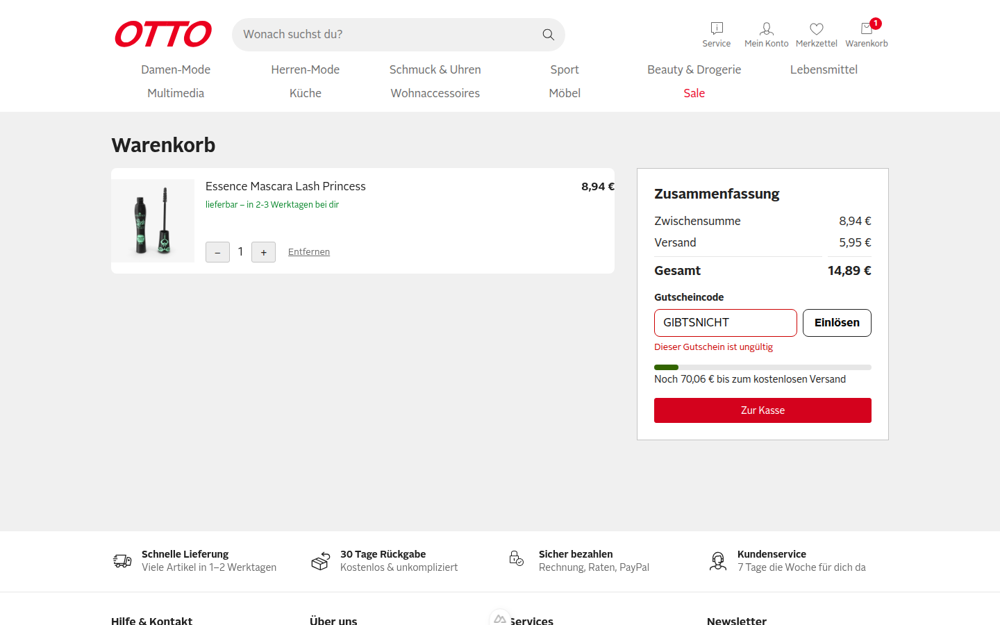
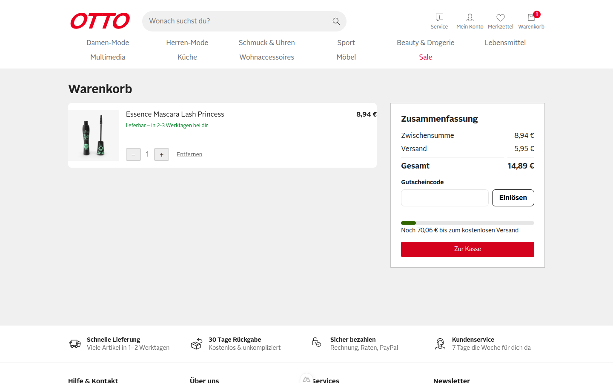
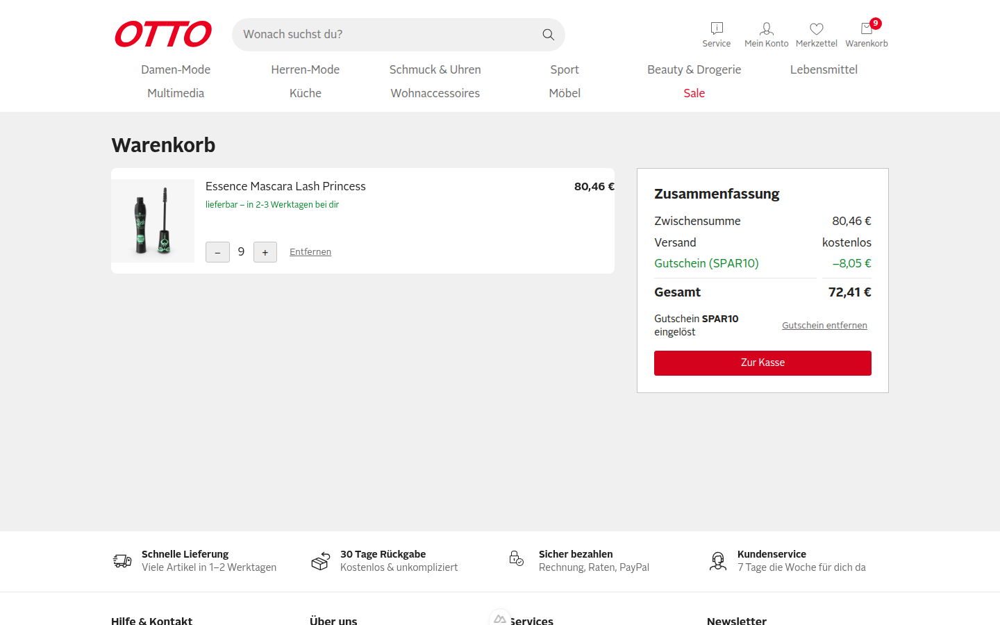
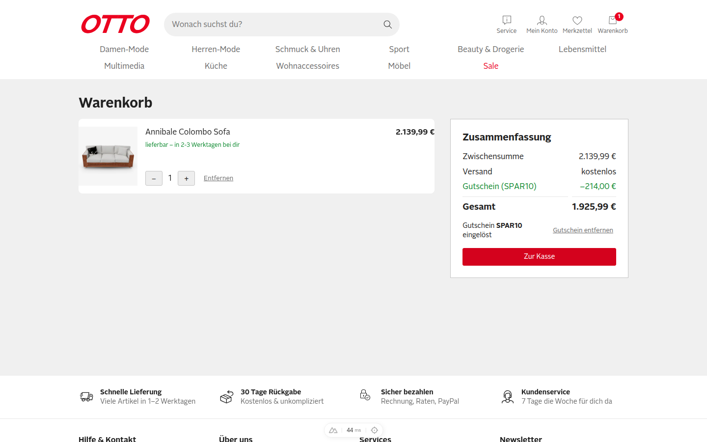
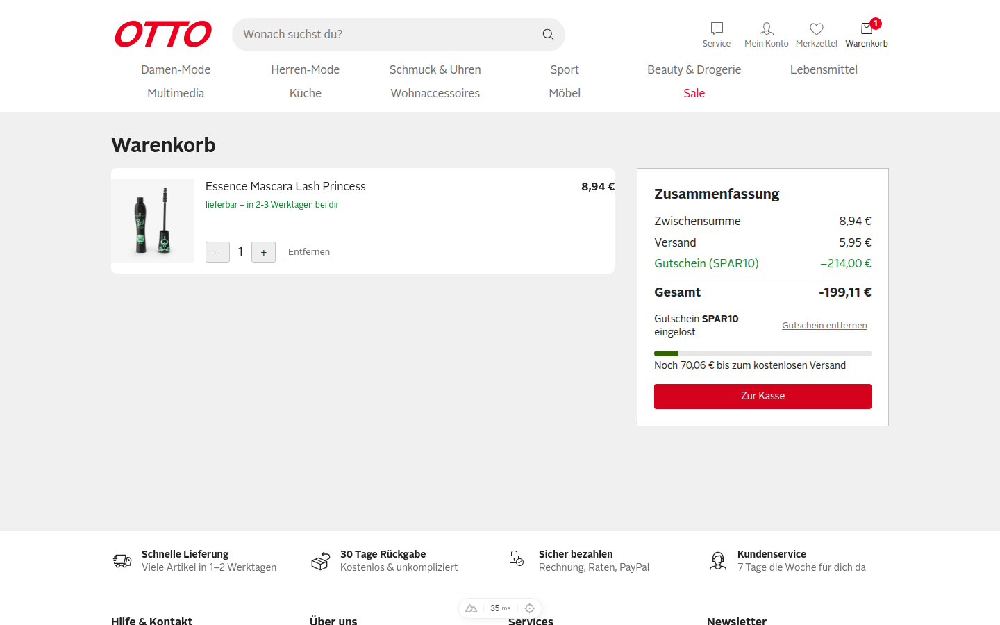
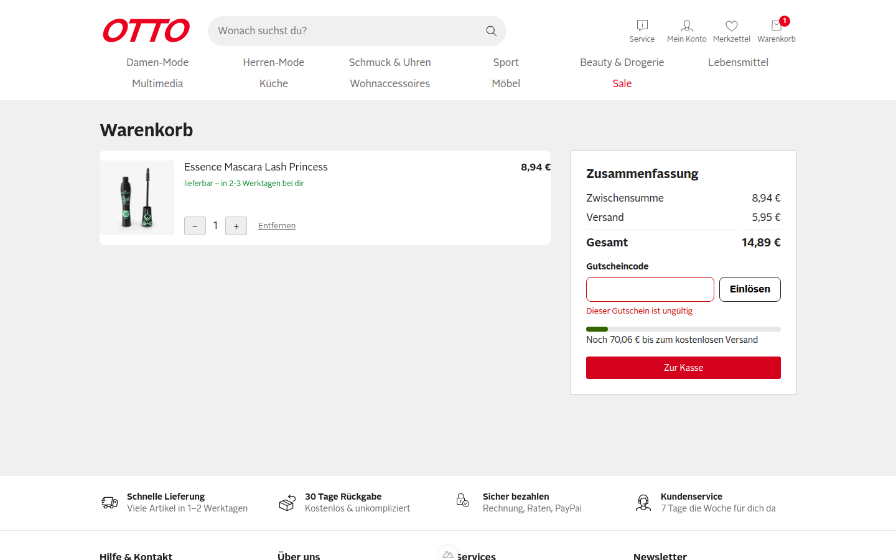

**Urteil: CRITICAL_BUGS**

# QA-Report: PR #1 – SHOP-42 Gutscheincode im Warenkorb einlösen (Issue #2)

Geprüft im echten Browser (agent-browser, Session `otto-verify-3100`, Viewport 1440×900) gegen http://localhost:3100, Commit `8233bee`. Der Warenkorb wurde immer über die Produktseite („In den Warenkorb“) befüllt. Cookies habe ich nie von Hand gesetzt.

[Video des Laufs](video/qa-run.webm)

## Ausgangszustand

Mascara (id 1) liegt im Warenkorb: Zwischensumme 8,94 €, Versand 5,95 €, Gesamt 14,89 €.

## Szenarien aus dem Issue

| # | Szenario | Ergebnis | Beleg |
|---|---|---|---|
| S1 | Gültiger Gutschein (`SPAR10`) | ✅ bestanden | Rabattzeile „Gutschein (SPAR10)“ −0,89 € (10 % von 8,94 €), Gesamt 14,89 € → 14,00 €, Cookie `otto-coupon=SPAR10` |
| S2 | Ungültiger Gutschein (`GIBTSNICHT`) | ✅ bestanden | Meldung „Dieser Gutschein ist ungültig“, Gesamt bleibt 14,89 €, kein `otto-coupon`-Cookie |
| S3 | Gutschein entfernen | ✅ bestanden | Rabattzeile verschwindet, Gesamt wieder 14,89 €, Cookie `otto-coupon` gelöscht |
| R | Regel: Gutschein bleibt nach Reload | ✅ bestanden | Nach Reload weiter −0,89 € / 14,00 € |

Die Szenarien bestehen nur mit **einer** festen Warenkorbmenge. Sobald sich der Warenkorb nach dem Einlösen ändert, stimmt die Regel „10 % auf die Zwischensumme“ nicht mehr (siehe F1/F2).

### S1 – Gültiger Gutschein

### S2 – Ungültiger Gutschein

### S3 – Gutschein entfernen

### Regel – Persistenz nach Reload

## Funde

### F1 – Rabatt wird beim Einlösen eingefroren und passt sich nicht an Mengenänderungen an · Severity: **Hoch (Major)**

Der Rabattbetrag wird beim Einlösen einmal berechnet und als festen Wert im Cookie `otto-coupon-amount` gespeichert (`app/composables/useCoupon.ts:15`). Ändert sich die Zwischensumme danach, bleibt der alte Betrag stehen. Ein Reload korrigiert das nicht.

**Repro A (Rabatt zu niedrig):**
1. Mascara (id 1) über die Produktseite in den Warenkorb legen, `/warenkorb` öffnen.
2. `SPAR10` einlösen → −0,89 €.
3. Mit `+` auf 9 Stück erhöhen (Zwischensumme 80,46 €).

- **Erwartet:** Gutschein −8,05 € (10 % von 80,46 €), Gesamt 72,41 €
- **Ist:** Gutschein bleibt −0,89 €, Gesamt 79,57 € (auch nach Reload)

**Repro B (Rabatt zu hoch):**
1. Bei 9 Stück (80,46 €) `SPAR10` einlösen → −8,05 €.
2. Mit `−` auf 1 Stück senken (Zwischensumme 8,94 €).

- **Erwartet:** Gutschein −0,89 €, Gesamt 14,00 €
- **Ist:** Gutschein bleibt −8,05 € (≈ 90 % Rabatt), Gesamt 6,84 €

### F2 – Gesamtsumme wird negativ (alter Gutschein-Betrag überlebt das Leeren des Warenkorbs) · Severity: **Kritisch**

Das Gutschein-Cookie (Code und fester Betrag) bleibt erhalten, wenn der Warenkorb geleert wird. Legt man danach einen billigen Artikel hinein, wird der alte, hohe Rabatt abgezogen. Die Gesamtsumme wird negativ.

**Repro:**
1. Sofa (id 12) über die Produktseite in den Warenkorb legen.
2. `SPAR10` einlösen → Zwischensumme 2.139,99 €, Gutschein −214,00 €, Gesamt 1.925,99 €.
3. Sofa mit „Entfernen“ löschen. Warenkorb ist leer, Cookies: `otto-coupon=SPAR10`, `otto-coupon-amount=214`.
4. Mascara (id 1) über die Produktseite hinzufügen, Warenkorb öffnen.

- **Erwartet:** Gutschein −0,89 € (10 % von 8,94 €), Gesamt 14,00 €. Der Rabatt darf nie größer als die Zwischensumme sein.
- **Ist:** Gutschein −214,00 €, **Gesamt −199,11 €**. „Zur Kasse“ ist weiter aktiv.

**Ursache (F1 und F2):** `discount` wird nicht aus `subtotal` abgeleitet, sondern aus dem gespeicherten Cookie `otto-coupon-amount`. Fix-Idee: nur den Code speichern und den Rabatt als `computed` berechnen, `Math.round(subtotal * rate * 100) / 100`, höchstens bis zur Zwischensumme. Nebenbefund: Der Betrag liegt in einem vom Client beschreibbaren Cookie. Wer das Cookie ändert, kann den Rabatt frei wählen. Das habe ich nicht im Browser getestet, es folgt aus dem Code.

### F3 – Leere Eingabe meldet „Dieser Gutschein ist ungültig“ · Severity: **Niedrig (UX)**

**Repro:** Im Warenkorb ohne Eingabe auf „Einlösen“ klicken.
- **Erwartet:** Hinweis wie „Bitte gib einen Gutscheincode ein“, oder der Button ist deaktiviert.
- **Ist:** „Dieser Gutschein ist ungültig“. Fachlich nicht falsch, aber irreführend.

## Explorativ geprüft, ohne Befund

- Kleinschreibung mit Leerzeichen (`"  spar10 "`) und Absenden per Enter wird als `SPAR10` eingelöst.
  
- Die Fehlermeldung verschwindet, sobald man wieder tippt.
- Höchstens ein Gutschein: Nach dem Einlösen wird das Eingabefeld durch „Gutschein SPAR10 eingelöst / Gutschein entfernen“ ersetzt. Ein zweiter Code lässt sich nicht eingeben (siehe Screenshot S1).
- Rundung: 0,894 € → 0,89 € und 8,046 € → 8,05 € (kaufmännisch).
- Die Versandschwelle 79 € gilt für die Zwischensumme vor Rabatt (80,46 € → Versand kostenlos).
