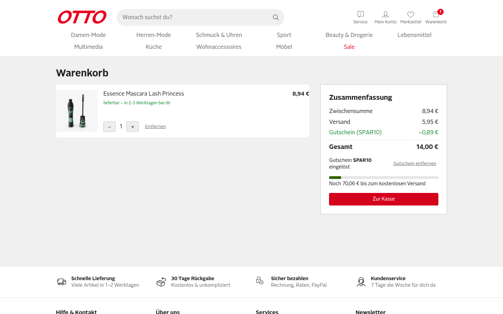
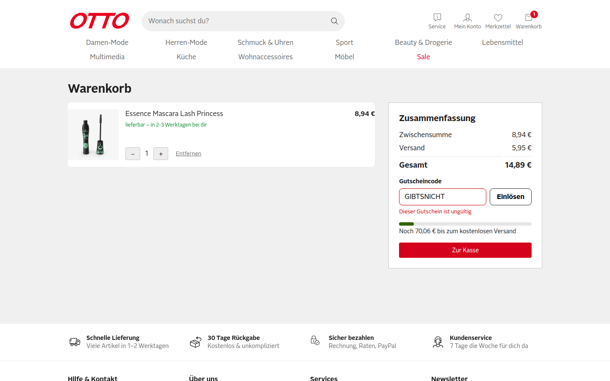
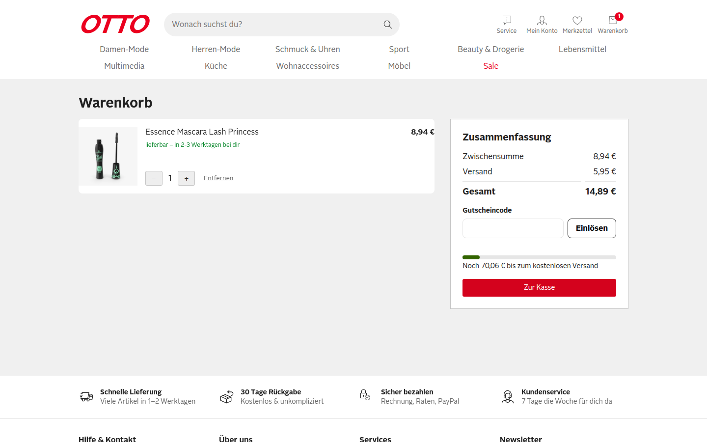
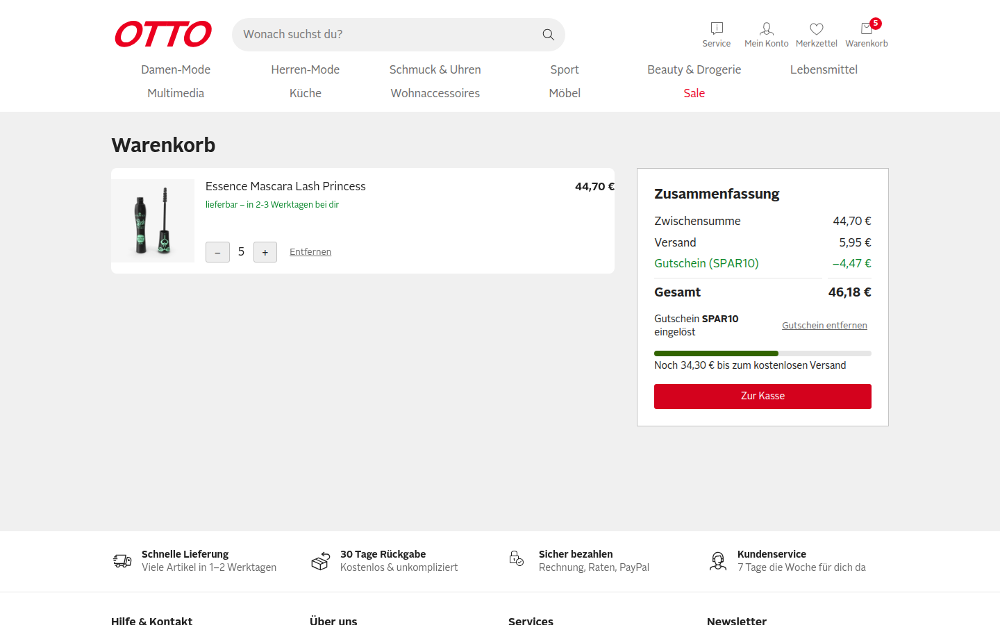
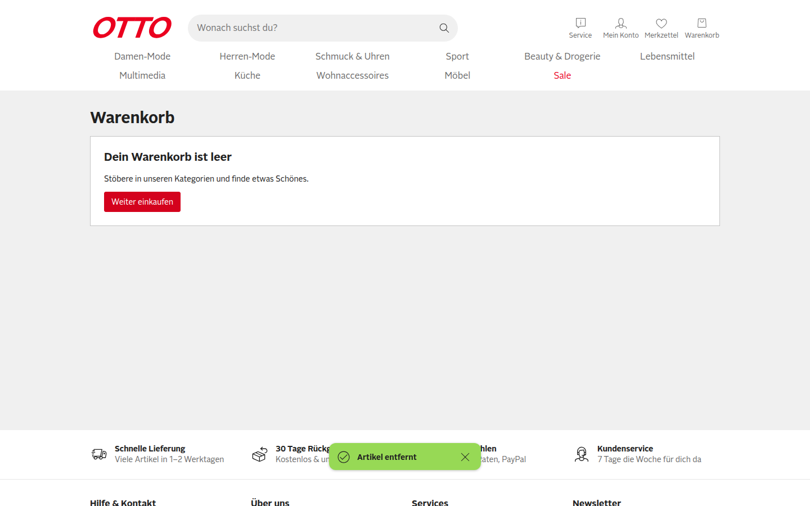
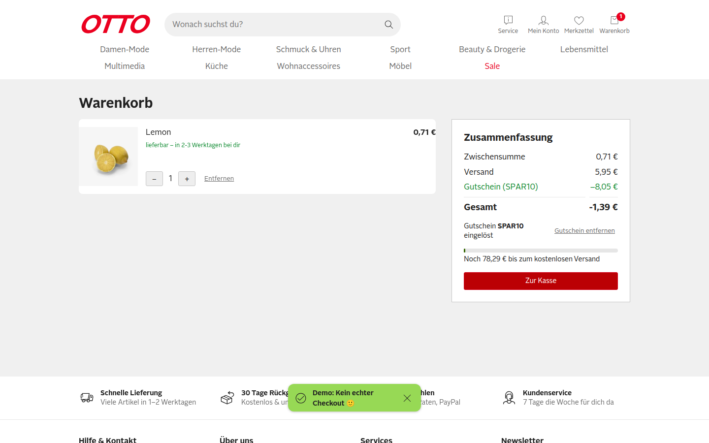
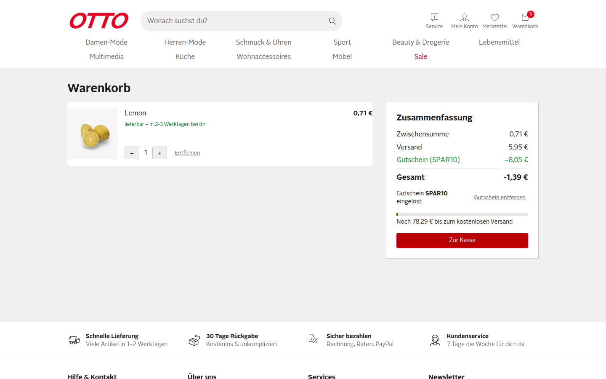
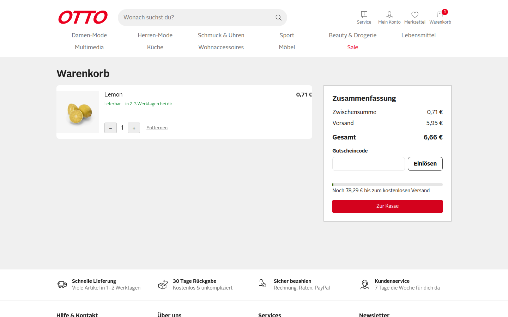
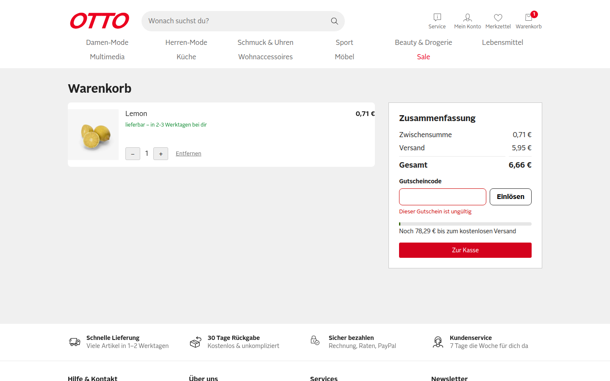

# QA-Report PR #1 – SHOP-42: Gutscheincode im Warenkorb einlösen

- **Ticket:** Issue #2 (verlinkt über `closingIssuesReferences`)
- **Umgebung:** Production-Build auf `http://localhost:3100`, Chromium über `agent-browser` (Session `otto-verify-3100`), Viewport 1440×900, Start mit leeren Cookies
- **Datum:** 2026-11-10
- **Vorgehen:** Der Warenkorb wurde immer über den echten Nutzerpfad befüllt (Produktseite → `In den Warenkorb` → Header-Link `Warenkorb`). Gutscheine wurden über das Feld `Gutscheincode` und den Button `Einlösen` oder die Enter-Taste eingelöst. Cookies wurden nur für den Manipulationstest (F4) von Hand gesetzt.

Alle drei Gherkin-Szenarien aus dem Ticket bestehen. Der Rabatt wird aber nur einmal beim Einlösen als fester Betrag berechnet und im Cookie `otto-coupon-amount` gespeichert (`app/composables/useCoupon.ts:14`). Ändert sich danach der Warenkorb, ist der Rabatt falsch. Die Gesamtsumme kann dadurch negativ werden.

## Szenarien aus dem Ticket

| # | Szenario | Ergebnis | Beobachtet |
|---|---|---|---|
| 1 | Gültiger Gutschein (`SPAR10`) | ✅ PASS | Zwischensumme 8,94 € → Zeile `Gutschein (SPAR10) −0,89 €` (10 %), Gesamt 14,89 € → 14,00 € (−0,89 €). Cookie `otto-coupon=SPAR10` |
| 2 | Ungültiger Gutschein (`GIBTSNICHT`) | ✅ PASS | Meldung `Dieser Gutschein ist ungültig`, Gesamt bleibt 14,89 €, keine Rabattzeile |
| 3 | Gutschein entfernen | ✅ PASS | Nach `Gutschein entfernen` ist die Rabattzeile weg, Gesamt wieder 14,89 €, Cookie `otto-coupon` gelöscht |
| R1 | Regel: Gutschein bleibt nach Reload | ✅ PASS | Nach `reload` weiterhin `−0,89 €` und Gesamt 14,00 € |
| R2 | Regel: höchstens ein Gutschein | ✅ PASS | Nach dem Einlösen ist das Eingabefeld weg, es gibt nur noch `Gutschein entfernen` |

### Szenario 1: Gültiger Gutschein

Vorher: ein Artikel (8,94 €), Gesamt 14,89 €.

Nachher: Rabattzeile `Gutschein (SPAR10) −0,89 €`, Gesamt 14,00 €.

### Szenario 2: Ungültiger Gutschein

### Szenario 3: Gutschein entfernen

### Regel R1: Gutschein bleibt nach Reload

### Regel R2: höchstens ein Gutschein / Eingabe-Normalisierung

`"  spar10 "` (Kleinschreibung, Leerzeichen) mit Enter wird als `SPAR10` eingelöst. Danach gibt es kein Eingabefeld mehr, ein zweiter Gutschein ist nicht möglich.

## Funde

### F1: Rabatt wächst nicht mit, wenn die Menge steigt (Severity: **Major**)

**Repro**
1. Produkt id 1 (8,94 €) in den Warenkorb legen, `/warenkorb` öffnen.
2. `SPAR10` einlösen → `−0,89 €`.
3. Mit `+` die Menge auf 5 erhöhen.

**Erwartet:** Rabatt = 10 % von 44,70 € = `−4,47 €`, Gesamt 46,18 €.
**Ist:** Der Rabatt bleibt `−0,89 €` (2 %), Gesamt 49,76 €. Das verletzt die Regel „10 % Rabatt auf die Zwischensumme“.

### F2: Rabatt bleibt hoch, wenn die Menge sinkt (Severity: **Critical**)

**Repro**
1. Produkt id 1 mit Menge 5 im Warenkorb (Zwischensumme 44,70 €).
2. `SPAR10` einlösen → `−4,47 €`, Gesamt 46,18 €.
3. Mit `−` auf Menge 1 reduzieren.

**Erwartet:** Rabatt `−0,89 €`, Gesamt 14,00 €.
**Ist:** Rabatt bleibt `−4,47 €` auf 8,94 € Zwischensumme (50 %), Gesamt 10,42 €. Der Shop gewährt also deutlich mehr Rabatt als erlaubt.

### F3: Gesamtsumme wird negativ; der Gutschein bleibt bei leerem Warenkorb bestehen (Severity: **Critical**)

**Repro**
1. Produkt id 1 auf Menge 9 bringen (Zwischensumme 80,46 €), `SPAR10` einlösen → `−8,05 €`.
2. Die Position mit `Entfernen` löschen → `Dein Warenkorb ist leer`. Die Cookies `otto-coupon=SPAR10` und `otto-coupon-amount=8.05` bleiben stehen.
3. Produkt id 31 (Lemon, 0,71 €) über die Produktseite in den Warenkorb legen, `/warenkorb` öffnen.
4. `Zur Kasse` klicken.

**Erwartet:** Rabatt `−0,07 €` (10 % von 0,71 €), Gesamt 6,59 €. Die Gesamtsumme darf nie unter 0 fallen.
**Ist:** Rabatt `−8,05 €`, **Gesamt `-1,39 €`**. `Zur Kasse` bleibt aktiv und zeigt den Checkout-Toast.

### F4: Code und Rabattbetrag werden ungeprüft aus Cookies übernommen (Severity: **Major**)

**Repro**
1. Mit eingelöstem `SPAR10` das Cookie `otto-coupon-amount` auf `500` setzen (DevTools bzw. `agent-browser cookies set`), Seite neu laden.
2. Zusätzlich `otto-coupon` auf einen erfundenen Code `FAKE50` und `otto-coupon-amount` auf `3` setzen, neu laden.

**Erwartet:** Der Rabatt wird aus einem bekannten Code und der aktuellen Zwischensumme berechnet. Unbekannte Codes und gespeicherte Beträge werden ignoriert.
**Ist:** Schritt 1: `Gutschein (SPAR10) −500,00 €`, Gesamt `-493,34 €`. Schritt 2: `Gutschein (FAKE50) −3,00 €` wird als gültiger Gutschein angezeigt und abgezogen.

Hinweis: Der Shop hat keinen echten Checkout. Sobald einer kommt, ist das ein direkt ausnutzbarer Preis-Exploit, wenn der Server diese Werte übernimmt.

### F5: Leere Eingabe meldet „ungültig“ (Severity: **Minor**)

**Repro:** Feld `Gutscheincode` leer lassen, `Einlösen` klicken.
**Erwartet:** Ein Hinweis wie „Bitte gib einen Gutscheincode ein“ oder ein deaktivierter Button.
**Ist:** `Dieser Gutschein ist ungültig`.

## Explorative Tests ohne Fund

- Kleinschreibung und Leerzeichen (`"  spar10 "`) werden normalisiert. ✅
- Absenden per Enter-Taste funktioniert. ✅
- Die Versandschwelle (79 €) richtet sich weiter nach der Zwischensumme vor Rabatt (bei 80,46 € Versand `kostenlos`, auch mit Rabatt). ✅
- Keine Fehler in der Browser-Konsole (`agent-browser errors` leer). ✅

## Ursache (Hinweis für die Entwicklung)

`useCoupon.redeem()` schreibt `amount = round(subtotal × 0.1)` einmalig ins Cookie `otto-coupon-amount`. `discount` liest danach nur diesen festen Wert, und `code` wird beim Lesen nicht gegen `COUPONS` geprüft. F1–F4 lassen sich beheben, wenn `discount` als `computed` aus einem gültigen `code` und dem aktuellen `subtotal` berechnet wird, das Cookie `otto-coupon-amount` entfällt und der Rabatt auf die Zwischensumme begrenzt wird.

Nebenbefund: Der PR enthält unter `docs/reports/` einen eigenen QA-Report samt Video und Screenshots. Diese Dateien gehören vermutlich nicht in den Merge.
