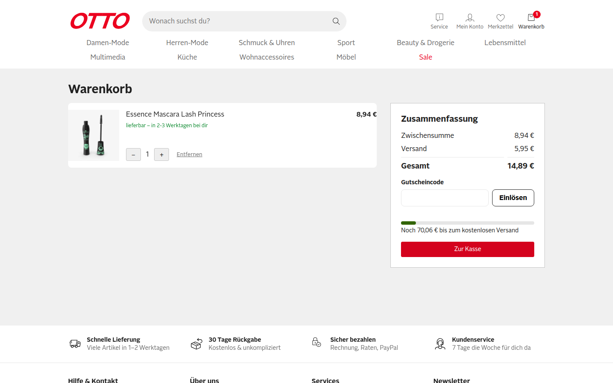
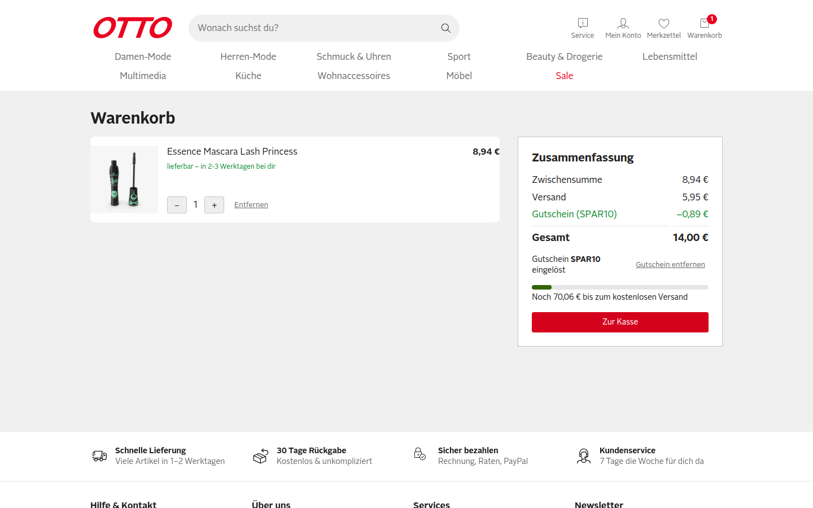
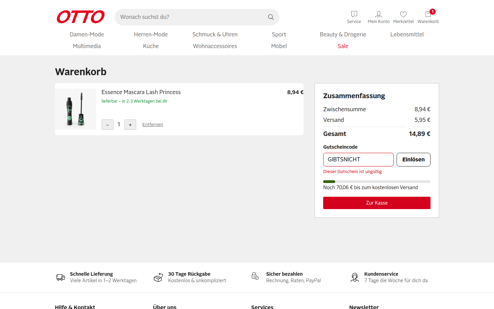
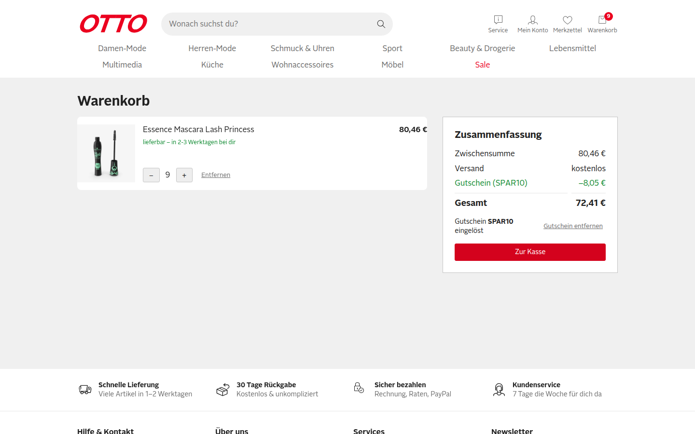
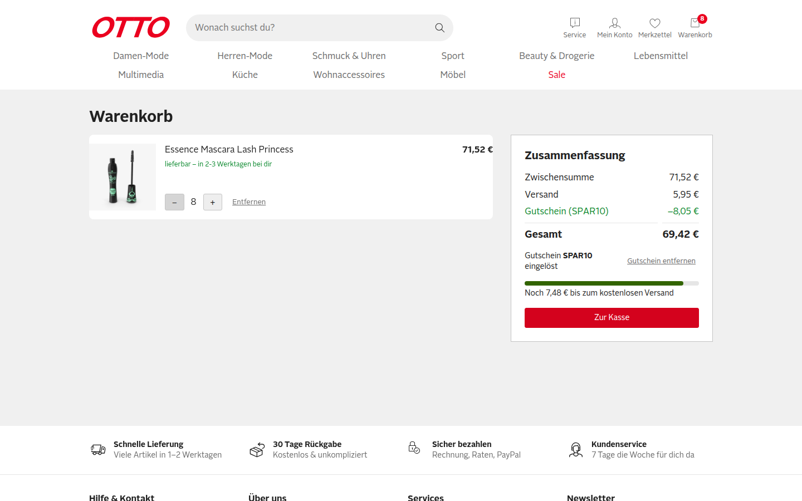
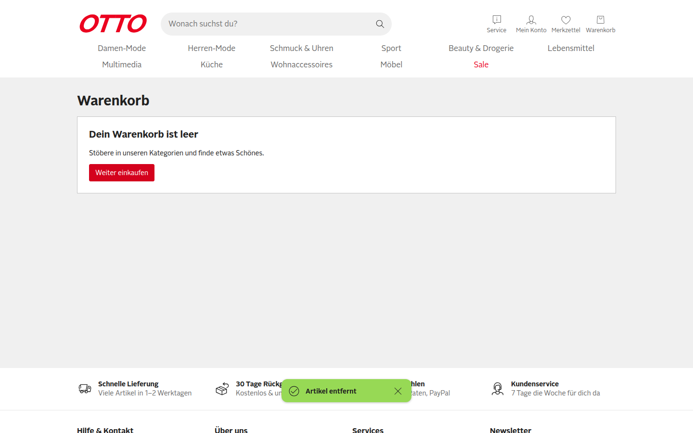
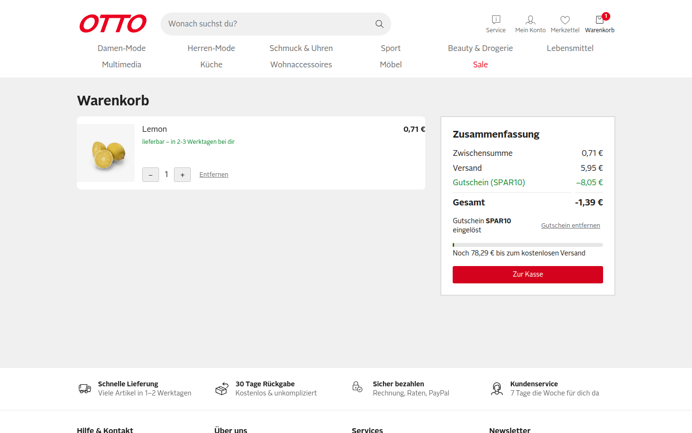
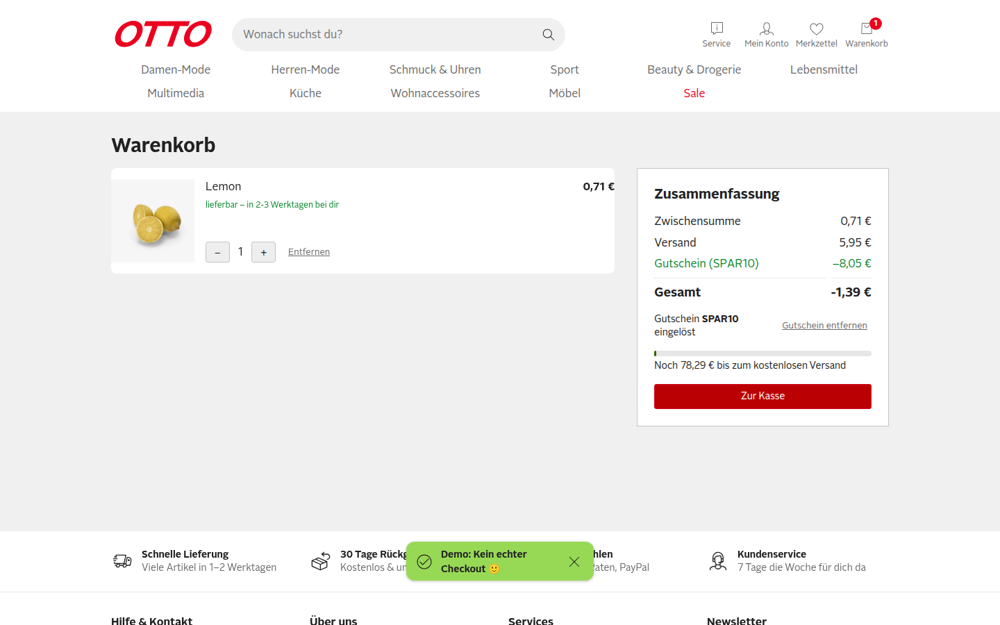
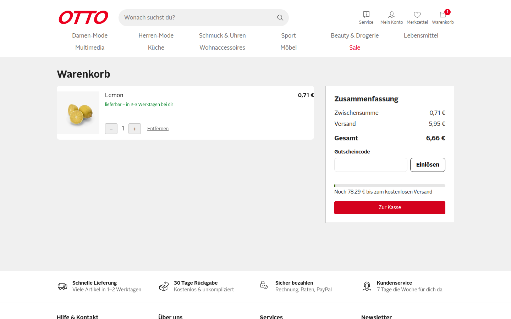
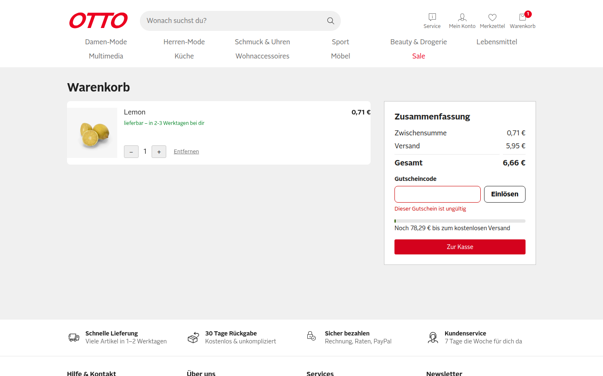

# QA-Report PR #1 – SHOP-42: Gutscheincode im Warenkorb einlösen

- **Ticket:** Issue #2 (verlinkt über `closingIssuesReferences`)
- **Umgebung:** Production-Build auf `http://localhost:3100`, Chromium über `agent-browser` (Session `otto-verify-3100`), Viewport 1440×900, Start mit leeren Cookies
- **Einstieg:** Warenkorb immer über Produktseite → `In den Warenkorb` → Header-Link `Warenkorb` befüllt (kein gesetztes Cookie). Einzige Ausnahme: F4 (bewusste Cookie-Manipulation).
- **Testdaten:** Produkt id 1 „Essence Mascara Lash Princess“ 8,94 €, Produkt id 31 „Lemon“ 0,71 €

Alle drei Gherkin-Szenarien bestehen. Der Rabatt wird aber nur **einmal beim Einlösen** berechnet und als fester Betrag im Cookie `otto-coupon-amount` gespeichert (`app/composables/useCoupon.ts:14`). Ändert sich danach der Warenkorb, stimmt der Rabatt nicht mehr. Im schlimmsten Fall wird die Gesamtsumme **negativ (−1,39 €)**, und „Zur Kasse“ bleibt klickbar.

## Szenarien aus dem Ticket

| # | Szenario | Ergebnis | Beobachtet |
|---|---|---|---|
| S1 | Gültiger Gutschein (`SPAR10`) | ✅ PASS | Zwischensumme 8,94 € → Zeile `Gutschein (SPAR10) −0,89 €`, Gesamt 14,89 € → 14,00 €, Cookie `otto-coupon=SPAR10` |
| S2 | Ungültiger Gutschein (`GIBTSNICHT`) | ✅ PASS | Meldung `Dieser Gutschein ist ungültig`, Gesamt bleibt 14,89 €, keine Rabattzeile |
| S3 | Gutschein entfernen | ✅ PASS | Rabattzeile weg, Gesamt wieder 14,89 €, Cookie `otto-coupon` gelöscht |
| R1 | Regel: Gutschein bleibt nach Reload | ✅ PASS | Nach `reload` weiter `−0,89 €` / Gesamt 14,00 € |
| R2 | Regel: höchstens ein Gutschein | ✅ PASS | Nach dem Einlösen ist das Eingabefeld weg (`.coupon__input` count = 0), nur `Gutschein entfernen` |

### S1: Gültiger Gutschein

### S2: Ungültiger Gutschein

### S3: Gutschein entfernen

### R1: Reload

### R2: Höchstens ein Gutschein (mit Kleinschreibung/Leerzeichen und Enter)

Eingabe `"  spar10 "`, abgeschickt mit Enter → als `SPAR10` eingelöst (−0,07 € auf 0,71 €), Eingabefeld verschwindet.

## Explorative Tests ohne Fund

- Kleinschreibung und führende/folgende Leerzeichen werden normalisiert. ✅
- Absenden per Enter-Taste funktioniert. ✅
- Keine Fehler in der Browser-Konsole (`agent-browser errors` leer). ✅

## Funde

### F1: Rabatt wächst bei höherer Menge nicht mit (Severity: **Major**)

**Repro**
1. Produkt id 1 (8,94 €) in den Warenkorb legen, `/warenkorb` öffnen.
2. `SPAR10` einlösen → `−0,89 €`.
3. Mit `+` die Menge auf 9 erhöhen (Zwischensumme 80,46 €).

**Erwartet:** Rabatt = 10 % von 80,46 € = `−8,05 €`, Gesamt 72,41 €.
**Ist:** Rabatt bleibt `−0,89 €`, Gesamt `79,57 €`. Schon bei Menge 2 falsch (−0,89 € statt −1,79 €).

### F2: Rabatt bleibt zu hoch, wenn die Menge sinkt (Severity: **Major**)

**Repro**
1. Produkt id 1 auf Menge 9 bringen (Zwischensumme 80,46 €).
2. `SPAR10` einlösen → `−8,05 €`.
3. Mit `−` auf Menge 8 reduzieren (Zwischensumme 71,52 €).

**Erwartet:** Rabatt `−7,15 €`, Gesamt 70,32 €.
**Ist:** Rabatt bleibt `−8,05 €`, Gesamt `69,42 €`. Der Kunde bekommt mehr als 10 %.

### F3: Gesamtsumme wird negativ; Gutschein überlebt einen leeren Warenkorb (Severity: **Critical**)

**Repro**
1. Wie F2 Schritte 1–3 (Rabatt `−8,05 €`).
2. Die Position mit `Entfernen` löschen → `Dein Warenkorb ist leer`. Cookies `otto-coupon=SPAR10` und `otto-coupon-amount=8.05` bleiben stehen.
3. Produkt id 31 (Lemon, 0,71 €) über die Produktseite in den Warenkorb legen, `/warenkorb` öffnen.
4. `Zur Kasse` klicken.

**Erwartet:** Rabatt `−0,07 €` (10 % von 0,71 €), Gesamt 6,59 €. Die Gesamtsumme darf nie unter 0 fallen.
**Ist:** Rabatt `−8,05 €`, **Gesamt `-1,39 €`**. `Zur Kasse` bleibt aktiv und zeigt den Checkout-Toast.

### F4: Rabattbetrag kommt ungeprüft aus einem Client-Cookie (Severity: **Major**)

**Repro**
1. Zustand aus F3 (SPAR10 eingelöst).
2. Cookie `otto-coupon-amount` auf `500` setzen (DevTools / `agent-browser cookies set otto-coupon-amount 500`).
3. Seite neu laden.

**Erwartet:** Rabatt wird aus Code und aktueller Zwischensumme berechnet; ein gespeicherter Betrag wird ignoriert.
**Ist:** `Gutschein (SPAR10) −500,00 €`, Gesamt `-493,34 €`.

Hinweis: Der Shop hat keinen echten Checkout. Sobald einer kommt, wäre das ein direkt ausnutzbarer Preis-Exploit.

### F5: Leere Eingabe meldet „ungültig“ (Severity: **Minor**)

**Repro:** Gutscheinfeld leer lassen, `Einlösen` klicken.
**Erwartet:** Hinweis wie „Bitte gib einen Gutscheincode ein“ oder ein deaktivierter Button.
**Ist:** `Dieser Gutschein ist ungültig`.

## Ursache (Hinweis für den Entwickler)

`useCoupon.redeem()` schreibt `amount = round(subtotal × 0.1)` einmalig ins Cookie `otto-coupon-amount`; `discount` liest danach nur diesen festen Wert. F1–F4 verschwinden, wenn `discount` als `computed` aus `code` und dem aktuellen `subtotal` berechnet wird, das Cookie `otto-coupon-amount` entfällt und der Rabatt auf die Zwischensumme begrenzt wird. Ein Test „Menge ändern nach Einlösen“ fehlt.

## Anmerkungen zum Lauf

- Der PR enthält einen eigenen QA-Report (`docs/reports/SHOP-42-qa-report.md`). Er wurde nicht als Beleg übernommen; alle Funde oben wurden in diesem Lauf unabhängig im Browser reproduziert.
- Die erste Videoaufnahme ging verloren (Zielordner fehlte). Das Video zeigt daher einen zweiten, kompakten Lauf: S1, R1, S3, S2, F1 (Menge 2) und F3 (Rabatt −0,89 € auf 0,71 € Zwischensumme nach Leeren des Warenkorbs). Die Screenshots stammen aus dem ersten, vollständigen Lauf.
