# QA-Report PR #1 – SHOP-42: Gutscheincode im Warenkorb einlösen (Issue #2)

- **Umgebung:** Production-Build auf `http://localhost:3100`, Chromium über `agent-browser` (Session `otto-verify-3100`), Viewport 1440×900

## Szenarien und Regeln aus dem Issue

| # | Szenario / Regel | Status | Beobachtet |
|---|---|---|---|
| S1 | Szenario: Gültiger Gutschein (`SPAR10`) | bestanden | Artikel id 1, Zwischensumme 8,94 €. Nach `SPAR10` + `Einlösen`: Zeile `Gutschein (SPAR10) −0,89 €`, Gesamt 14,89 € → 14,00 €, Cookie `otto-coupon=SPAR10` |
| S2 | Szenario: Ungültiger Gutschein (`GIBTSNICHT`) | bestanden | Meldung `Dieser Gutschein ist ungültig`, Gesamt bleibt 14,89 €, keine Rabattzeile, kein `otto-coupon`-Cookie |
| S3 | Szenario: Gutschein entfernen | bestanden | Nach `SPAR10` (Gesamt 14,00 €) und `Gutschein entfernen`: Rabattzeile weg, Gesamt 14,89 €, `otto-coupon` gelöscht |
| R1 | Regel: `SPAR10` gibt 10 % Rabatt auf die Zwischensumme | bestanden (im Moment des Einlösens) | 10 % von 8,94 € = 0,894 → −0,89 €. Ändert sich der Warenkorb danach, stimmen die 10 % nicht mehr: siehe Funde F1–F3 |
| R2 | Regel: Pro Bestellung höchstens ein Gutschein | bestanden | Nach dem Einlösen ist das Eingabefeld weg (`#coupon-code` count = 0), nur `Gutschein entfernen` |
| R3 | Regel: Rabatt als eigene Zeile „Gutschein (SPAR10)“ | bestanden | Eigene `dt`/`dd`-Zeile in der Zusammenfassung |
| R4 | Regel: Gutschein bleibt nach Reload erhalten | bestanden | Nach `reload` weiter `−0,89 €` und Gesamt 14,00 € |

**S1 / R1 / R2 / R3 – Ergebnis:**

**R4 – nach Reload:**

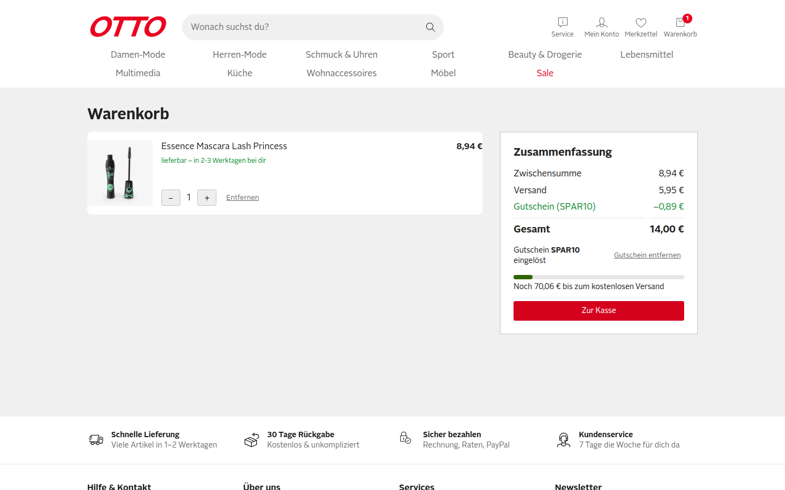

**S3 – Gutschein entfernt:**

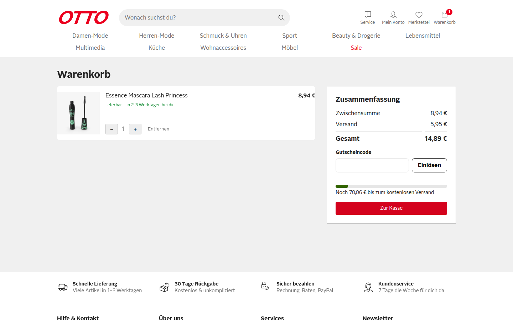

**S2 – Ungültiger Gutschein:**

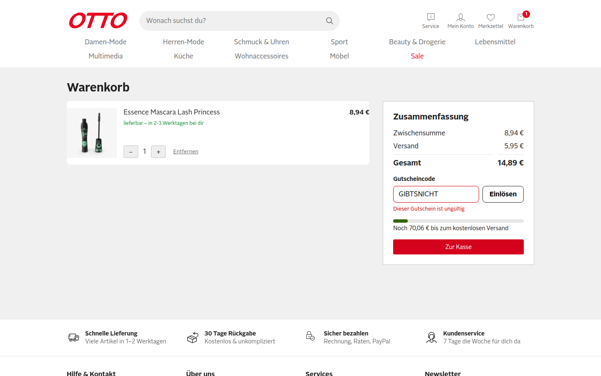

## Risiken aus dem Diff

1. **Rabatt als fester Betrag im Cookie** (`app/composables/useCoupon.ts:7,15`): Der Betrag wird nur beim Einlösen berechnet. Ändert sich danach die Menge, kann der Rabatt nicht mehr 10 % der Zwischensumme sein.
2. **Gutschein-Cookie überlebt leeren Warenkorb** (`useCoupon.ts`, kein Bezug zu `cart`): Nach Entfernen aller Artikel und neuem Befüllen gilt ein alter Betrag, Gesamt kann negativ werden.
3. **Gesamtsumme ohne Untergrenze** (`app/pages/warenkorb.vue:66`): `cart.total - discount + shipping` wird nicht auf ≥ 0 begrenzt.
4. **Eingabe-Normalisierung** (`useCoupon.ts:12`): `trim().toUpperCase()` – leere Eingabe, Leerzeichen, Kleinschreibung, Sonderzeichen.
5. **Versandschwelle und Rabatt** (`warenkorb.vue:6-7`): Versand rechnet auf Zwischensumme vor Rabatt; Wechselwirkung an der 79-€-Grenze.

## Explorative Tests

| # | Charter | Ergebnis |
|---|---|---|
| E1 | Erkunde die Code-Eingabe mit Kleinschreibung, Leerzeichen und Enter-Taste, um Fehler in der Normalisierung zu finden (Risiko 4). | ok: `"  spar10 "` + Enter wird als `SPAR10` eingelöst, −0,89 € |
| E2 | Erkunde den Rabatt nach dem Einlösen mit Menge rauf (`+` bis 5), um veraltete Rabattbeträge zu finden (Risiko 1). | **Fund F1** |
| E3 | Erkunde den Rabatt nach dem Einlösen mit Menge runter (9 → 1), um zu hohe Rabatte zum Schaden des Shops zu finden (Risiko 1). | **Fund F2** |
| E4 | Erkunde den Gutschein über einen leer geräumten und neu befüllten Warenkorb mit `Entfernen` und einem günstigen Artikel, um negative Summen zu finden (Risiken 2, 3). | **Fund F3** |
| E5 | Erkunde die Code-Eingabe mit leerem Feld, um unpassende Fehlermeldungen zu finden (Risiko 4). | **Fund F4** (Minor) |
| E6 | Erkunde das Einlösen mit Doppelklick auf `Einlösen`, um doppelte Rabatte zu finden (Regel R2). | ok: genau eine Rabattzeile, −0,07 € auf 0,71 €, Gesamt 6,59 € |
| E7 | Erkunde die Gutschein-Steuerung in mobiler Breite (390×844), um Layoutfehler zu finden. | ok: Eingabe, Button, Fehlermeldung und `Gutschein entfernen` lesbar, nichts überläuft |
| E8 | Erkunde die Versandschwelle mit Rabatt an der 79-€-Grenze, um falsche Versandkosten zu finden (Risiko 5). | Beobachtung aus E3: 80,46 € − 8,05 € = Gesamt 72,41 €, Versand kostenlos (Schwelle zählt vor Rabatt). Das Issue regelt das nicht; die Skill-Doku im PR nennt es gewollt. Kein Fund |

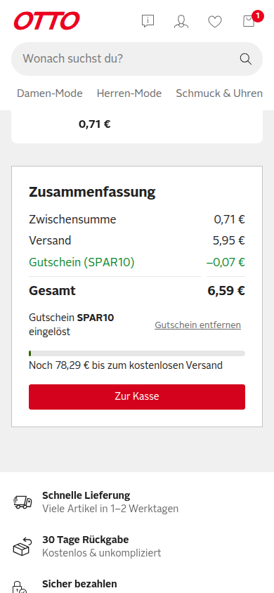

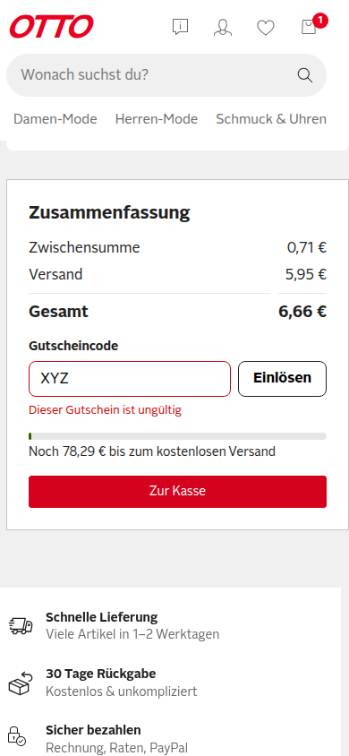

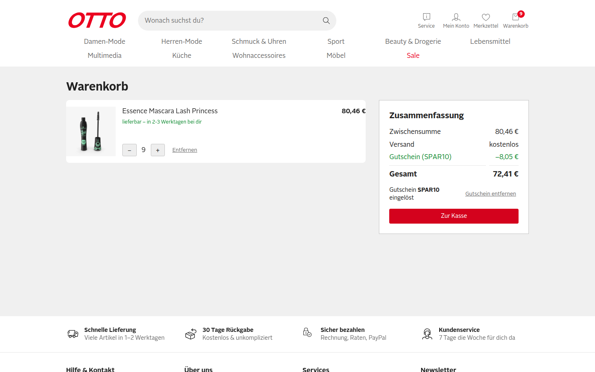

## Funde

### F1: Rabatt wächst bei höherer Menge nicht mit (Severity: **Critical**)

Begründung der Stufe: Summe falsch zum Schaden des Kunden (zu wenig Rabatt), Regel R1 „10 % auf die Zwischensumme“ verletzt.

**Repro**
1. Cookies leeren, Produkt id 1 (8,94 €) über die Produktseite in den Warenkorb legen, über den Header `/warenkorb` öffnen.
2. `SPAR10` einlösen → `Gutschein (SPAR10) −0,89 €`, Gesamt 14,00 €.
3. Mit `+` die Menge auf 5 erhöhen.

**Erwartet:** Rabatt = 10 % von 44,70 € = −4,47 €, Gesamt 46,18 €.
**Ist:** Rabatt bleibt −0,89 €, Gesamt 49,76 €.
**Ursache:** `app/composables/useCoupon.ts:15` berechnet den Betrag nur einmal in `redeem()` und speichert ihn im Cookie `otto-coupon-amount` (`useCoupon.ts:7`). `discount` (`useCoupon.ts:9`) liest nur diesen festen Wert und hängt nicht von `subtotal` ab.

Vorher (Menge 1, −0,89 €):

Nachher (Menge 5, weiter −0,89 €):

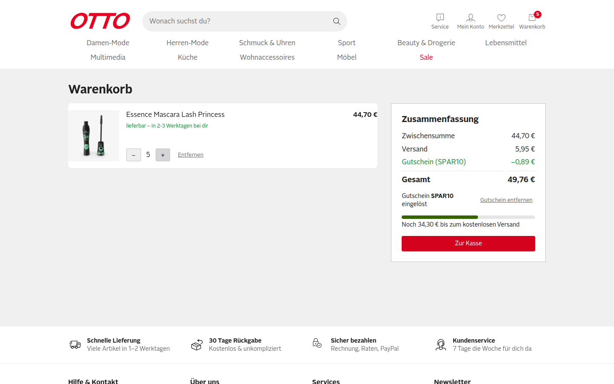

### F2: Rabatt bleibt hoch, wenn die Menge sinkt (Severity: **Critical**)

Begründung der Stufe: Summe falsch zum Schaden des Shops (≈ 90 % statt 10 % Rabatt).

**Repro**
1. Cookies leeren, Produkt id 1 in den Warenkorb, auf `/warenkorb` mit `+` auf Menge 9 (Zwischensumme 80,46 €).
2. `SPAR10` einlösen → `−8,05 €`, Gesamt 72,41 €.
3. Mit `−` auf Menge 1 reduzieren.

**Erwartet:** Rabatt −0,89 €, Gesamt 14,00 €.
**Ist:** Rabatt bleibt −8,05 € auf 8,94 € Zwischensumme, Gesamt 6,84 €.
**Ursache:** wie F1, `app/composables/useCoupon.ts:15` (einmalige Berechnung) und `useCoupon.ts:9` (`discount` ohne Bezug zu `subtotal`).

Vorher (Menge 9, −8,05 €):

Nachher (Menge 1, weiter −8,05 €):

### F3: Gutschein überlebt leeren Warenkorb, Gesamtsumme wird negativ (Severity: **Critical**)

Begründung der Stufe: Gesamtsumme negativ zum Schaden des Shops; `Zur Kasse` bleibt sichtbar.

**Repro**
1. Cookies leeren, Produkt id 13 (Bedside Table, 242,72 €) in den Warenkorb, `/warenkorb` öffnen.
2. `SPAR10` einlösen → `−24,27 €`, Gesamt 218,45 €.
3. Position mit `Entfernen` löschen → `Dein Warenkorb ist leer`. Cookies: `otto-cart=%5B%5D`, `otto-coupon=SPAR10`, `otto-coupon-amount=24.27` bleiben stehen.
4. Produkt id 31 (Lemon, 0,71 €) über die Produktseite in den Warenkorb legen, `/warenkorb` öffnen.

**Erwartet:** Rabatt 10 % von 0,71 € = −0,07 €, Gesamt 6,59 €. Die Gesamtsumme darf nie unter 0 fallen.
**Ist:** `Gutschein (SPAR10) −24,27 €`, **Gesamt `-17,61 €`**, `Zur Kasse` weiter angeboten.
**Ursache:** `app/composables/useCoupon.ts:6-7,15` – Code und fester Betrag liegen in eigenen Cookies ohne Bezug zum Warenkorb; nichts setzt sie zurück, wenn der Warenkorb leer wird. `app/pages/warenkorb.vue:66` – `cart.total.value - coupon.discount.value + shipping` ohne Begrenzung auf ≥ 0 und ohne Begrenzung des Rabatts auf die Zwischensumme.

Vorher (Warenkorb leer, Gutschein-Cookies stehen noch):

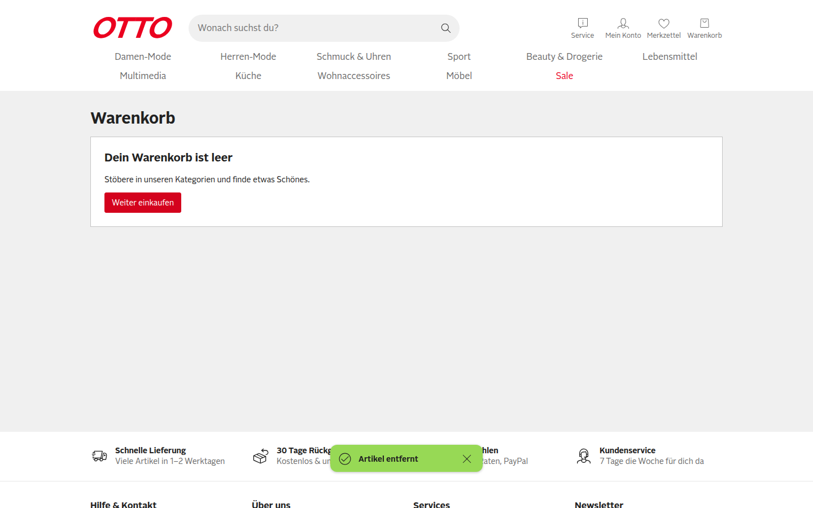

Nachher (Lemon 0,71 €, Gesamt −17,61 €):

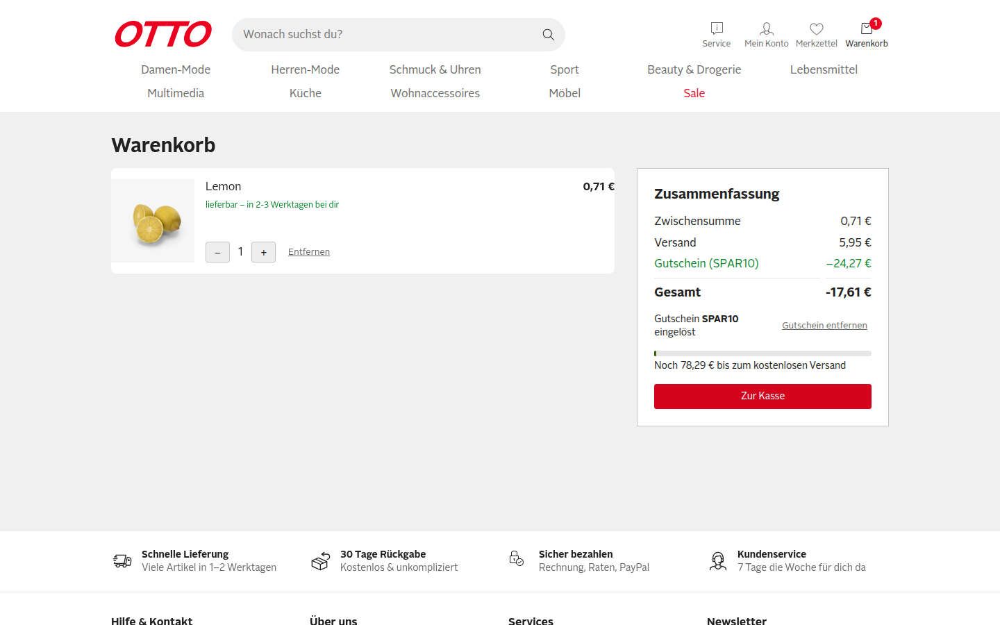

### F4: Leere Eingabe meldet „Dieser Gutschein ist ungültig“ (Severity: **Minor**)

**Repro**
1. Artikel im Warenkorb, kein Gutschein eingelöst.
2. Feld `Gutscheincode` leer lassen, `Einlösen` klicken.

**Erwartet:** Hinweis wie „Bitte gib einen Gutscheincode ein“ oder ein deaktivierter Button.
**Ist:** `Dieser Gutschein ist ungültig`, Feld rot umrandet. Summen bleiben korrekt.
**Ursache:** `app/composables/useCoupon.ts:12-13` prüft nur, ob der normalisierte Code in `COUPONS` liegt; `app/pages/warenkorb.vue:19` setzt für jeden Fehlschlag dieselbe Meldung. Kein eigener Fall für leere Eingabe.

Vorher:

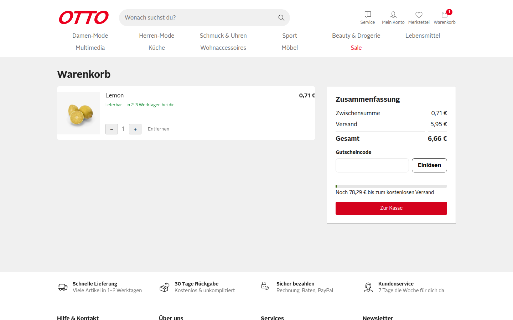

Nachher:

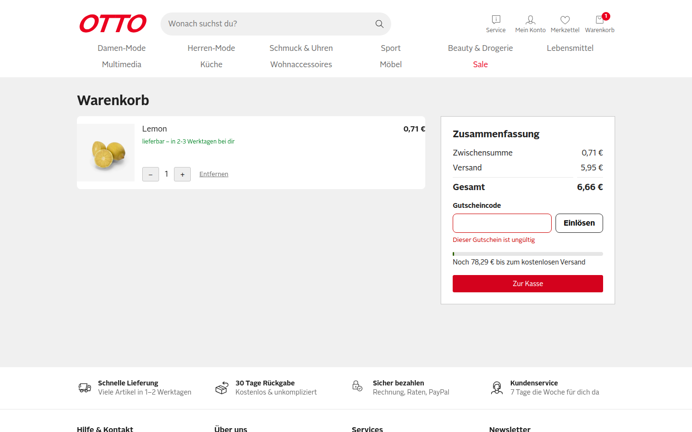

## Nicht getestet

- **Video des Laufs:** Die Aufnahme wurde gestartet, beim Stoppen meldete `agent-browser` `ffmpeg write failed: Broken pipe`. Ursache: Der Ordner `qa-report/video/` existierte beim Start nicht. Es liegt kein Video vor; die Belege sind die Screenshots.
- **Vorher-Screenshot zu S1:** Der erste Screenshot schlug fehl, weil `qa-report/screenshots/` noch nicht existierte. Der Vorher-Zustand (Gesamt 14,89 €) ist per `get text ".summary__rows"` belegt und in S2/S3 als Screenshot sichtbar.
- **Manipulation des Cookies `otto-coupon-amount`:** kein Kundenweg, daher nicht getestet. Laut Code (`useCoupon.ts:7,9`) wird der Betrag ungeprüft aus dem Cookie gelesen; die Behebung von F1–F3 (Rabatt aus Code und aktueller Zwischensumme berechnen) beseitigt das mit.
- **Echter Checkout:** existiert im Demo-Shop nicht (`Zur Kasse` zeigt nur einen Toast).
- **Andere Browser als Chromium:** nicht getestet.

Hinweis zum Testablauf: Ein erster Versuch von E4 klickte mit `find role button click --name "Entfernen"` (ohne `--exact`) den Button `Gutschein entfernen` statt die Position. Der Lauf wurde mit `--exact` sauber wiederholt; die Screenshots 09/10 stammen aus der Wiederholung.
