# QA-Report PR #1 – SHOP-42: Gutscheincode im Warenkorb einlösen (Issue #2)

- **Umgebung:** Production-Build auf `http://localhost:3100`, Chromium über `agent-browser` (Session `otto-verify-3100`), Viewport 1440×900
- **Testbasis:** Issue #2 (Regeln + Gherkin-Akzeptanzkriterien)

## Szenarien und Regeln aus dem Issue

| # | Szenario / Regel | Status | Beobachtet |
|---|---|---|---|
| S1 | Szenario: Gültiger Gutschein (`SPAR10`) | bestanden | Artikel id 1 (8,94 €) über Produktseite in den Warenkorb. `SPAR10` eingelöst → Zeile `Gutschein (SPAR10) −0,89 €`, Gesamt 14,89 € → 14,00 €, Cookie `otto-coupon=SPAR10` |
| S2 | Szenario: Ungültiger Gutschein (`GIBTSNICHT`) | bestanden | Meldung `Dieser Gutschein ist ungültig`, Gesamt bleibt 14,89 €, keine Rabattzeile, kein `otto-coupon`-Cookie |
| S3 | Szenario: Gutschein entfernen | bestanden | Nach `Gutschein entfernen`: Rabattzeile weg, Gesamt wieder 14,89 €, `otto-coupon` gelöscht (`otto-coupon-amount=0` bleibt stehen) |
| R1 | Regel: `SPAR10` gibt 10 % Rabatt auf die Zwischensumme | bestanden (im Moment des Einlösens) | 0,89 € = 10 % von 8,94 €. Nach Mengenänderung siehe Funde |
| R2 | Regel: Pro Bestellung höchstens ein Gutschein | bestanden | Nach dem Einlösen ist das Eingabefeld weg (`#coupon-code` count = 0), nur `Gutschein entfernen` |
| R3 | Regel: Rabatt als eigene Zeile „Gutschein (SPAR10)“ | bestanden | Eigene `dt/dd`-Zeile in der Zusammenfassung |
| R4 | Regel: Gutschein bleibt nach Reload erhalten | bestanden | Nach `reload` weiter `−0,89 €`, Gesamt 14,00 € |

**S1 vorher:**

**S1 / R1 / R2 / R3 Ergebnis:**
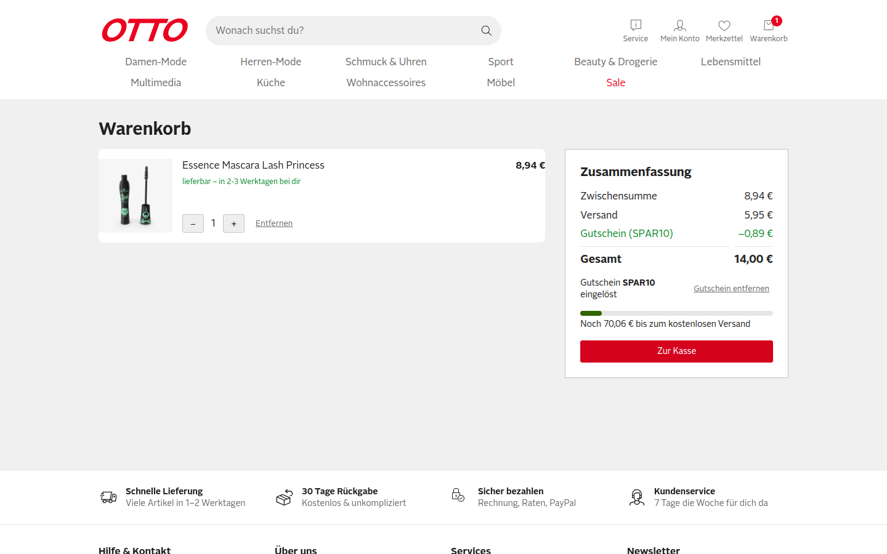

**R4 Ergebnis:**

**S3 Ergebnis:**
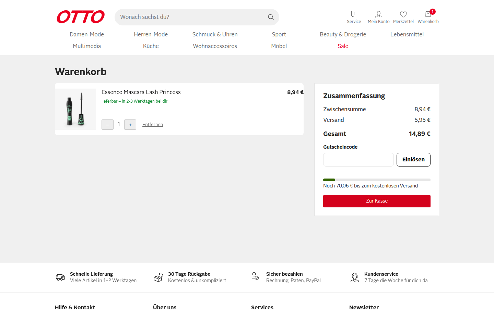

**S2 Ergebnis:**
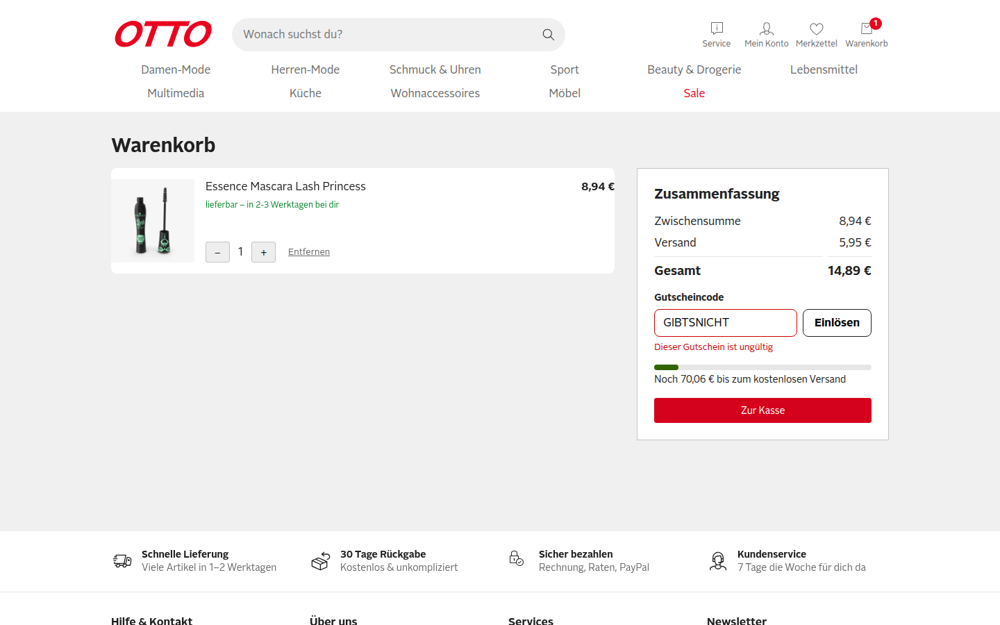

## Risiken aus dem Diff

1. **Rabatt als fester Betrag gespeichert** – `app/composables/useCoupon.ts:7,15` speichert den Rabatt einmalig beim Einlösen im Cookie `otto-coupon-amount`. Daran hängen Rabattzeile und Gesamtsumme. Ändert sich danach die Menge, kann der Rabatt nicht mehr 10 % der Zwischensumme sein (zu niedrig oder zu hoch).
2. **Keine Untergrenze für die Gesamtsumme** – `app/pages/warenkorb.vue` rechnet `cart.total - discount + shipping` ohne Begrenzung. Ist der Rabatt größer als die Zwischensumme, kann Gesamt negativ werden.
3. **Gutschein-Cookie überlebt Entfernen/Leeren des Warenkorbs** – nichts setzt `otto-coupon`/`otto-coupon-amount` zurück, wenn der Warenkorb leer wird. Ein alter Rabatt kann auf einen neuen Warenkorb wirken.
4. **Eingabe-Normalisierung** – `redeem()` nutzt `trim().toUpperCase()` und `in COUPONS`. Leere Eingabe, Leerzeichen, Kleinschreibung oder Namen wie `constructor`/`toString` (Prototyp-Schlüssel) können falsch behandelt werden.
5. **SSR/Hydration und Layout** – Gutschein-UI hängt an einem Cookie, das im SSR gelesen wird; neue Formular-Elemente in der Zusammenfassung können auf mobiler Breite das Layout brechen.

## Explorative Tests

| # | Charter | Ergebnis |
|---|---|---|
| E1 | Erkunde die Gutschein-Eingabe mit Kleinschreibung, Leerzeichen und Enter-Taste, um Fehler bei der Normalisierung zu finden (Risiko 4). | Kein Fund: `"  spar10 "` + Enter wird als `SPAR10` eingelöst |
| E2 | Erkunde den Rabatt nach dem Einlösen mit Menge rauf (1 → 5) und Reload, um einen veralteten Rabattbetrag zu finden (Risiko 1). | **F1** |
| E3 | Erkunde den Rabatt nach dem Einlösen mit Menge runter (9 → 1), um einen zu hohen Rabatt zu finden (Risiko 1). | **F2** |
| E4 | Erkunde Entfernen der Position und Neubefüllen mit einem billigen Artikel bei aktivem Gutschein, um negative Summen und hängengebliebene Gutscheine zu finden (Risiko 2 + 3). | **F3** |
| E5 | Erkunde die Gutschein-Eingabe mit leerem Feld und Prototyp-Schlüssel (`constructor`), um falsche Annahme oder falsche Meldungen zu finden (Risiko 4). | **F4** (leeres Feld). `constructor` wird korrekt abgelehnt |
| E6 | Erkunde das Einlösen mit Doppelklick, um doppelte Rabatte zu finden (Regel R2). | Kein Fund: genau eine Rabattzeile `−0,07 €` (10 % von 0,71 €), Gesamt 6,59 € |
| E7 | Erkunde die Zusammenfassung mit Gutschein auf 390×844, um Layoutbrüche zu finden (Risiko 5). | Kein Fund: Rabattzeile, Text und `Gutschein entfernen` passen in die Breite |
| E8 | Erkunde Navigation weg und Zurück-Button bei aktivem Gutschein, um verlorenen Zustand oder Hydration-Fehler zu finden (Risiko 5). | Kein Fund: Gutschein und Summe bleiben, `agent-browser errors` leer |

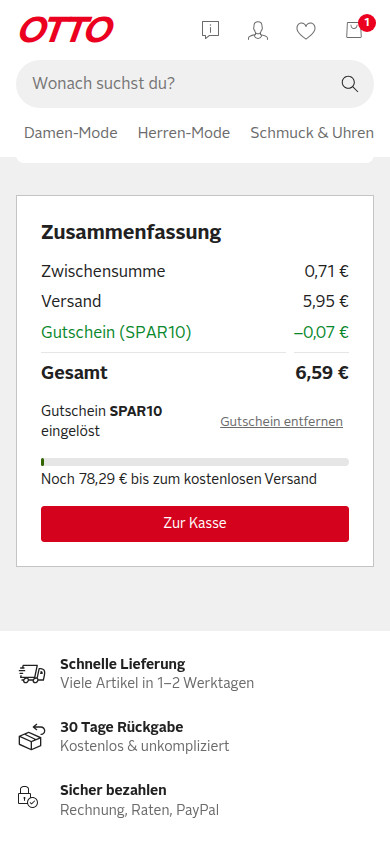
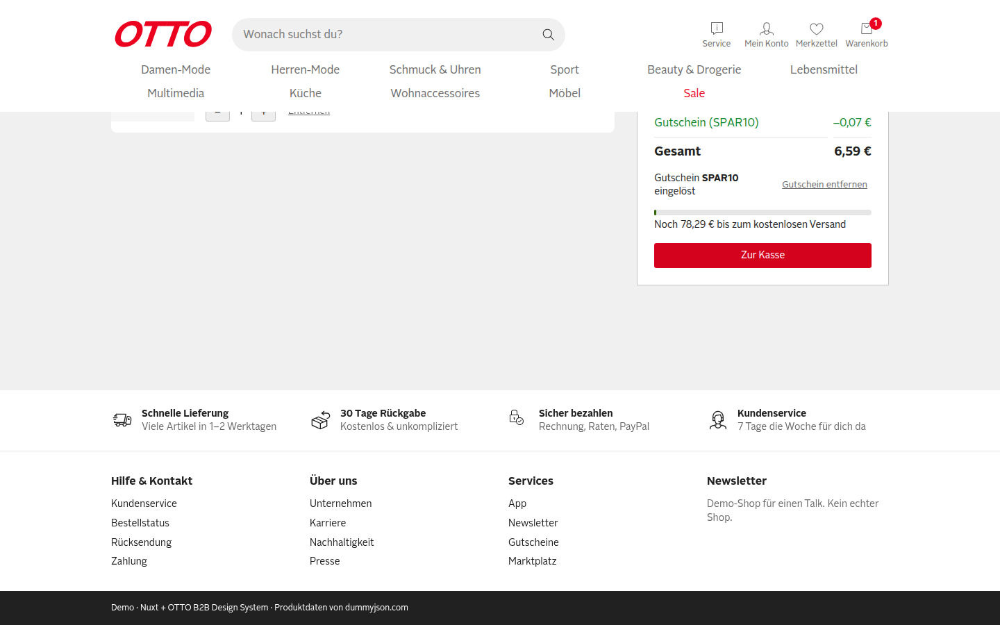

Hinweis zum Ablauf: Ein erster Klick auf `Entfernen` ohne `--exact` traf im Tool die Schaltfläche `Gutschein entfernen` (Teiltreffer im Namen). Das ist ein Selektor-Artefakt von `agent-browser`, kein Shop-Fehler; E4 wurde danach mit `--exact` wiederholt.

## Funde

### F1: Rabatt wächst bei höherer Menge nicht mit (Severity: **Critical**)

**Repro**
1. Cookies leeren, Produkt id 1 (8,94 €) über die Produktseite in den Warenkorb legen, `/warenkorb` über den Header öffnen.
2. `SPAR10` einlösen → `Gutschein (SPAR10) −0,89 €`, Gesamt 14,00 €.
3. Mit `+` die Menge auf 5 erhöhen (Zwischensumme 44,70 €). Optional: Reload.

**Erwartet:** Rabatt = 10 % von 44,70 € = `−4,47 €`, Gesamt 46,18 € (Regel R1: 10 % auf die Zwischensumme).
**Ist:** Rabatt bleibt `−0,89 €`, Gesamt `49,76 €`. Auch nach Reload unverändert. Der Kunde zahlt 3,58 € zu viel.
**Severity-Begründung:** Summe falsch zum Schaden des Kunden → Critical.
**Ursache:** `app/composables/useCoupon.ts:15` berechnet `amount` einmalig beim Einlösen und speichert ihn im Cookie `otto-coupon-amount` (`useCoupon.ts:7`). `discount` (`useCoupon.ts:9`) liest nur diesen festen Wert und hängt nicht mehr von `subtotal` ab.

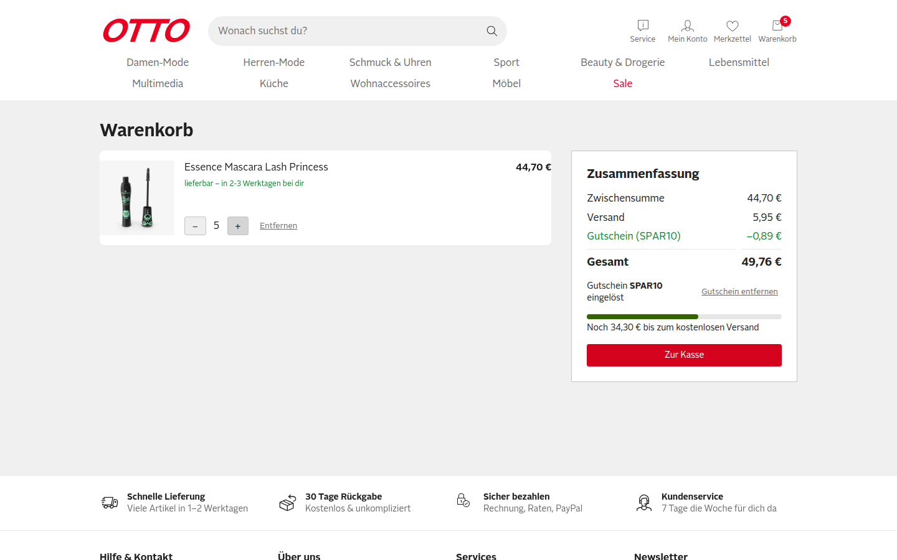

### F2: Rabatt bleibt hoch, wenn die Menge sinkt (Severity: **Critical**)

**Repro**
1. Produkt id 1 im Warenkorb auf Menge 9 bringen (Zwischensumme 80,46 €).
2. `SPAR10` einlösen → `−8,05 €`, Gesamt 72,41 €.
3. Mit `−` auf Menge 1 reduzieren.

**Erwartet:** Rabatt `−0,89 €` (10 % von 8,94 €), Gesamt 14,00 €.
**Ist:** Rabatt bleibt `−8,05 €` auf 8,94 € Zwischensumme (≈ 90 %), Gesamt `6,84 €`. Der Shop verliert 7,16 €.
**Severity-Begründung:** Summe falsch zum Schaden des Shops → Critical.
**Ursache:** wie F1, `app/composables/useCoupon.ts:15` (fester Betrag beim Einlösen) und `useCoupon.ts:9` (`discount` ignoriert die aktuelle Zwischensumme).

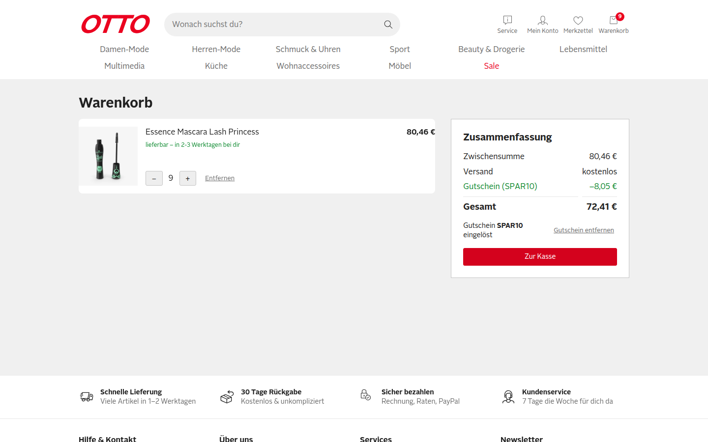

### F3: Gesamtsumme wird negativ, der Gutschein überlebt einen leeren Warenkorb (Severity: **Critical**)

**Repro**
1. Wie F2 Schritte 1–2 (Menge 9, `SPAR10` → `−8,05 €`).
2. Die Position mit `Entfernen` löschen → `Dein Warenkorb ist leer`. Cookies: `otto-cart=[]`, aber `otto-coupon=SPAR10` und `otto-coupon-amount=8.05` bleiben.
3. Produkt id 31 (Lemon, 0,71 €) über die Produktseite in den Warenkorb legen, Warenkorb öffnen.
4. `Zur Kasse` klicken.

**Erwartet:** Rabatt `−0,07 €` (10 % von 0,71 €), Gesamt 6,59 €. Die Gesamtsumme darf nie negativ werden.
**Ist:** Rabatt `−8,05 €`, **Gesamt `-1,39 €`**. `Zur Kasse` bleibt aktiv und zeigt den Demo-Checkout-Toast.
**Severity-Begründung:** Summe falsch (negativ) zum Schaden des Shops → Critical.
**Ursache:** `app/composables/useCoupon.ts:15` (fester Betrag) plus fehlende Begrenzung in `app/pages/warenkorb.vue` (Gesamt-Zeile `formatEuro(cart.total.value - coupon.discount.value + shipping)`, `app/pages/warenkorb.vue:66`). Kein Code im Diff setzt den Gutschein zurück, wenn der Warenkorb leer wird.

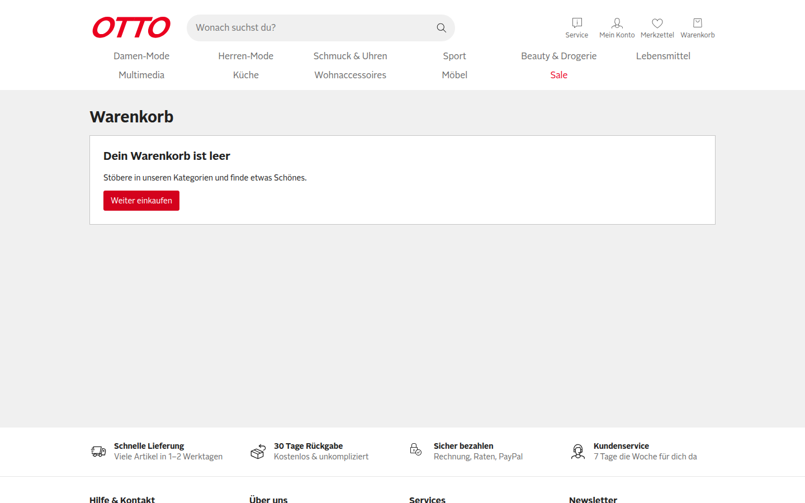
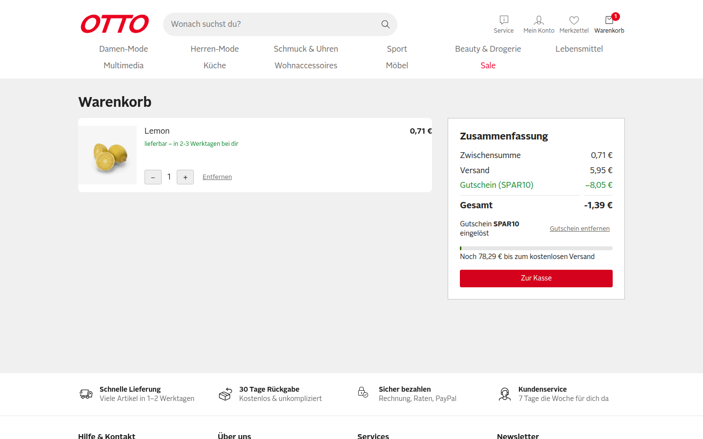

### F4: Leere Eingabe meldet „Dieser Gutschein ist ungültig“ (Severity: **Minor**)

**Repro**
1. Mit Artikel im Warenkorb das Feld `Gutscheincode` leer lassen.
2. `Einlösen` klicken.

**Erwartet:** Hinweis wie „Bitte gib einen Gutscheincode ein“ oder ein deaktivierter `Einlösen`-Button.
**Ist:** `Dieser Gutschein ist ungültig`. Summen bleiben korrekt, kein Schaden.
**Ursache:** `app/pages/warenkorb.vue` `redeemCoupon()` (neue Zeilen ab 13) unterscheidet nicht zwischen leerer und unbekannter Eingabe; `useCoupon.ts:13` liefert für `""` einfach `false`.

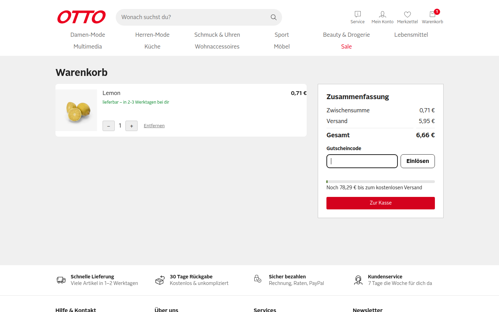
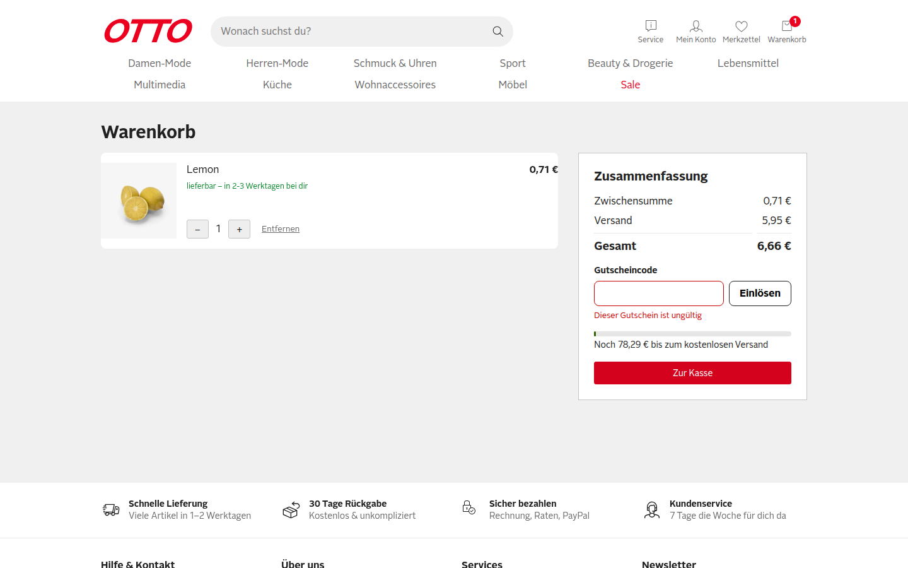

## Nicht getestet

- **Manipulation des Cookies `otto-coupon-amount`** (Rabattbetrag kommt ungeprüft aus dem Client, `useCoupon.ts:7`): nicht im Browser geprüft, weil ein gesetztes Cookie keinen Kundenweg darstellt. Aus dem Code ist das Risiko klar ersichtlich; die Behebung von F1–F3 (Rabatt als `computed` aus Code + aktueller Zwischensumme) beseitigt es mit.
- **Echter Checkout / Bestellung:** Der Shop hat nur einen Demo-Toast, daher nicht testbar.
- **Weitere Gutscheincodes:** Das Issue definiert nur `SPAR10`.
- **Andere Browser als Chromium:** nur Chromium über `agent-browser` verfügbar.
- **Hinweis:** Der PR enthält unter `docs/reports/SHOP-42-*` einen eigenen QA-Bericht. Er wurde als Daten behandelt, nicht als Beleg; alle Ergebnisse oben wurden unabhängig im Browser ermittelt.
